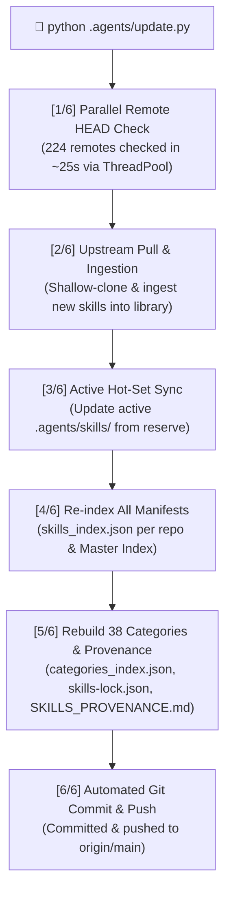

# ⚡ AgentSkills Vault (`SeaXen/agentskills`)

<div align="center">

[](./skills)
[](./agents)
[](./workflows)
[](./category)
[](./SKILLS_PROVENANCE.md)
[](./library)
[](./Skill.Sea)

**The premier, production-grade intelligence suite and modular skill repository for autonomous AI agents.**  
Compatible with **Antigravity IDE**, **Claude Code**, **Cursor**, **Windsurf**, and **Cline**.

*90 active hot-set skills, 38 functional domain categories (6,063 unique categorized skills), 20 specialist personas, 18 autonomous workflows, and 7,312 master reserve skills across 224 repositories.*

[Quick Start](#-the-3-command-cheat-sheet) • [Skill.Sea Web App](#-skillsea--interactive-web-dashboard) • [38-Domain Categories](#-38-domain-functional-categories-taxonomy) • [Automated Updater](#-unified-automated-updater-updatepy) • [Agents](#-specialist-agents-20-personas) • [Workflows](#-autonomous-workflows-18-slash-commands) • [Provenance](./SKILLS_PROVENANCE.md)

</div>

---

## 🌟 What is AgentSkills Vault?

AgentSkills Vault solves the single greatest limitation of modern AI coding assistants: **context degradation from tool overloading**.

Instead of dumping thousands of skills into an AI session—which exhausts token budgets, causes hallucination, and degrades model performance—AgentSkills implements a **Decoupled 2-Tier Architecture**:

1. **⚡ Active Hot-Set (`.agents/skills/`)**: A lean, razor-sharp active tier of **90 battle-tested core skills** loaded into your active session.
2. **🏛️ Master Reserve Warehouse (`.agents/library/`)**: An offline, zero-token reserve of **7,312 modular skills across 224 repositories**, organized into **38 human-navigable domain categories** in [`.agents/category/`](./category).
3. **🌊 Skill.Sea Visual Dashboard (`.agents/Skill.Sea/`)**: An ultra-fast, local web dashboard running at `http://localhost:8080` to search, filter, preview, and 1-click activate skills on demand.
4. **🔄 Unified Automated Multi-Repo Updater (`.agents/update.py`)**: A parallel-threaded update engine that checks all 224 GitHub remotes in ~25 seconds, downloads new skills, rebuilds taxonomy indexes, and pushes updates to GitHub.

---

## 🚦 The 3-Command Cheat Sheet

Everything in AgentSkills can be operated with just **3 essential commands**:

### 1️⃣ Search & Find Any Skill
Search across all 7,312 skills by name, description, or keyword:
```powershell
python .agents/library/activate_skill.py search animation
python .agents/library/activate_skill.py search "smart contract"
```
*(Or visually search in your browser via [Skill.Sea](#-skillsea--interactive-web-dashboard) at `http://localhost:8080`)*

### 2️⃣ Activate / Link a Skill into Your Project
Temporarily link or permanently copy any skill into your active hot-set:
```powershell
# Soft-link (zero disk duplication, instant):
python .agents/library/activate_skill.py link hyperframes

# Full copy into .agents/skills/:
python .agents/library/activate_skill.py activate hyperframes
```

### 3️⃣ Update Everything & Backup to GitHub
One command pulls fresh upstream skills from all 224 repositories, updates categories, re-indexes manifests, and pushes cleanly to GitHub:
```powershell
python .agents/update.py
```

---

## 🌊 Skill.Sea — Interactive Web Dashboard

Located in [`.agents/Skill.Sea/`](./Skill.Sea):

Skill.Sea is the standalone, high-performance web directory and leaderboard for your skills vault. Built with vanilla JavaScript, modern CSS, and a lightweight Node server, it requires zero heavy dependencies.

```text
       ┌─────────────────────────────────────────────────────────────┐
       │  🌊 Skill.Sea — Autonomous Agent Skills Vault & Leaderboard  │
       │  [ 🔍 Search 7,300+ skills... ]    [ 🏷️ 38 Categories ▾ ]   │
       ├─────────────────────────────────────────────────────────────┤
       │  🟢 Active (90)  │  📦 All Skills (7,312)  │  🏆 Leaderboard │
       ├─────────────────────────────────────────────────────────────┤
       │  radix-ui-design-system    • 🟢 Active  • Frontend (Radix)  │
       │  emil-design-eng           • 🟢 Active  • UI Motion & Craft  │
       │  systematic-debugging      • 🟢 Active  • 4-Phase Diagnosis  │
       │  solidity-security         • ⚪ Reserve • Smart Contract QA  │
       │  [ + 1-Click Activate ]    [ 📖 View SKILL.md ]             │
       └─────────────────────────────────────────────────────────────┘
```

### Starting the Skill.Sea Web Dashboard:
```powershell
cd .agents/Skill.Sea
npm start
# Open browser at http://localhost:8080
```
- **Instant Search**: Sub-millisecond client-side filtering across 7,312 skills.
- **Category Matrix**: Browse and filter through all 38 functional domains.
- **One-Click Activation**: Toggle skills between Active Hot-Set and Offline Reserve.
- **Live Leaderboard**: Discover the highest-rated community skills (inspired by SkillLeaderboard).

---

## 🗂️ 38-Domain Functional Categories Taxonomy

All **6,063 unique skills** are cataloged into **38 granular functional domains** in [`.agents/category/`](./category). Every directory contains real standalone skill folders, an individual `README.md` catalog, and a machine-readable `skills_index.json`:

| Category Directory | Domain Title | Skills Count | Individual Catalog |
| :--- | :--- | :---: | :--- |
| **[`code-quality-refactoring`](./category/code-quality-refactoring)** | 🧹 Code Quality, Refactoring & Clean Code | **1126** | [Open Catalog](./category/code-quality-refactoring/README.md) |
| **[`database-sql-relational`](./category/database-sql-relational)** | 🗄️ SQL Databases, ORMs & Indexing | **824** | [Open Catalog](./category/database-sql-relational/README.md) |
| **[`backend-api-design`](./category/backend-api-design)** | ⚡ Backend Systems, REST & Microservices | **380** | [Open Catalog](./category/backend-api-design/README.md) |
| **[`frontend-ui-components`](./category/frontend-ui-components)** | 🎨 Frontend Components & Design Systems | **363** | [Open Catalog](./category/frontend-ui-components/README.md) |
| **[`business-sales-crm`](./category/business-sales-crm)** | 📈 Sales Outreach, Leads & CRM | **228** | [Open Catalog](./category/business-sales-crm/README.md) |
| **[`academic-writing-publishing`](./category/academic-writing-publishing)** | 📚 Academic Writing, Research & Literature | **228** | [Open Catalog](./category/academic-writing-publishing/README.md) |
| **[`prompt-llm-engineering`](./category/prompt-llm-engineering)** | 💬 Prompt Engineering, LLMs & RAG | **226** | [Open Catalog](./category/prompt-llm-engineering/README.md) |
| **[`architecture-system-design`](./category/architecture-system-design)** | 🏛️ Architecture, System Design & Patterns | **210** | [Open Catalog](./category/architecture-system-design/README.md) |
| **[`scientific-bio-data`](./category/scientific-bio-data)** | 🔬 Scientific Bio-Informatics & Laboratory | **194** | [Open Catalog](./category/scientific-bio-data/README.md) |
| **[`autonomous-agents-hermes`](./category/autonomous-agents-hermes)** | 🧠 NousResearch Hermes Agent Skills | **169** | [Open Catalog](./category/autonomous-agents-hermes/README.md) |
| **[`testing-unit-tdd`](./category/testing-unit-tdd)** | 🧪 Unit Testing, TDD & Verification | **152** | [Open Catalog](./category/testing-unit-tdd/README.md) |
| **[`business-strategy-legal`](./category/business-strategy-legal)** | 📋 Business Strategy, Legal & HR | **151** | [Open Catalog](./category/business-strategy-legal/README.md) |
| **[`security-compliance-auth`](./category/security-compliance-auth)** | 🔒 Auth, Hardening & Compliance | **143** | [Open Catalog](./category/security-compliance-auth/README.md) |
| **[`data-engineering-ml`](./category/data-engineering-ml)** | 📊 Data Pipelines, BigQuery & Machine Learning | **127** | [Open Catalog](./category/data-engineering-ml/README.md) |
| **[`devops-docker-cicd`](./category/devops-docker-cicd)** | 🚀 DevOps, Containers & Deployment | **120** | [Open Catalog](./category/devops-docker-cicd/README.md) |
| **[`programming-languages-core`](./category/programming-languages-core)** | 📐 Programming Languages & Type Systems | **115** | [Open Catalog](./category/programming-languages-core/README.md) |
| **[`git-version-control`](./category/git-version-control)** | 🐙 Git, Worktrees & PR Workflows | **112** | [Open Catalog](./category/git-version-control/README.md) |
| **[`business-finance-accounting`](./category/business-finance-accounting)** | 💰 Financial Modeling, Tax & Accounting | **94** | [Open Catalog](./category/business-finance-accounting/README.md) |
| **[`productivity-workspace-tools`](./category/productivity-workspace-tools)** | 🚀 Productivity, Slack, Notion & Linear | **93** | [Open Catalog](./category/productivity-workspace-tools/README.md) |
| **[`terminal-system-tools`](./category/terminal-system-tools)** | 💻 Terminal, Shell & System Automation | **91** | [Open Catalog](./category/terminal-system-tools/README.md) |
| **[`frontend-motion-animation`](./category/frontend-motion-animation)** | ✨ UI Motion, Animations & Polish | **90** | [Open Catalog](./category/frontend-motion-animation/README.md) |
| **[`cloudflare-edge`](./category/cloudflare-edge)** | ☁️ Cloudflare Workers, Pages & Edge | **85** | [Open Catalog](./category/cloudflare-edge/README.md) |
| **[`mobile-ios-android`](./category/mobile-ios-android)** | 📱 Mobile Development (iOS, Android, React Native) | **82** | [Open Catalog](./category/mobile-ios-android/README.md) |
| **[`audio-voice-sound`](./category/audio-voice-sound)** | 🎙️ Audio, Voice Cloning & Sound Design | **81** | [Open Catalog](./category/audio-voice-sound/README.md) |
| **[`video-motion-production`](./category/video-motion-production)** | 🎬 Video Creation & Generative Motion | **68** | [Open Catalog](./category/video-motion-production/README.md) |
| **[`security-vulnerability-audit`](./category/security-vulnerability-audit)** | 🛡️ Vulnerability Auditing & Pentesting | **67** | [Open Catalog](./category/security-vulnerability-audit/README.md) |
| **[`algorithms-logic`](./category/algorithms-logic)** | 🧮 Algorithms, Logic & Math | **65** | [Open Catalog](./category/algorithms-logic/README.md) |
| **[`testing-playwright-e2e`](./category/testing-playwright-e2e)** | 🎭 Playwright & Browser Automation | **54** | [Open Catalog](./category/testing-playwright-e2e/README.md) |
| **[`lobehub-ecosystem`](./category/lobehub-ecosystem)** | 🌐 LobeHub Agent Skills Suite | **54** | [Open Catalog](./category/lobehub-ecosystem/README.md) |
| **[`diagrams-technical-visuals`](./category/diagrams-technical-visuals)** | 📊 Technical Diagrams & Isometric SVG | **50** | [Open Catalog](./category/diagrams-technical-visuals/README.md) |
| **[`web3-smart-contracts`](./category/web3-smart-contracts)** | 🪙 Web3, Solidity & DeFi Architecture | **46** | [Open Catalog](./category/web3-smart-contracts/README.md) |
| **[`graphics-branding-design`](./category/graphics-branding-design)** | 🎨 Visual Design, Branding & Graphics | **40** | [Open Catalog](./category/graphics-branding-design/README.md) |
| **[`frontend-visual-taste`](./category/frontend-visual-taste)** | 👁️ Visual Taste, Critique & Typography | **36** | [Open Catalog](./category/frontend-visual-taste/README.md) |
| **[`multi-agent-orchestration`](./category/multi-agent-orchestration)** | 🤖 Multi-Agent Systems & Swarms | **35** | [Open Catalog](./category/multi-agent-orchestration/README.md) |
| **[`database-nosql-serverless`](./category/database-nosql-serverless)** | ⚡ NoSQL, Serverless & Vector DBs | **26** | [Open Catalog](./category/database-nosql-serverless/README.md) |
| **[`3d-web-threejs`](./category/3d-web-threejs)** | 🧊 3D Web Experiences & Three.js | **14** | [Open Catalog](./category/3d-web-threejs/README.md) |
| **[`fullstack-web-frameworks`](./category/fullstack-web-frameworks)** | 🌐 Fullstack Web Frameworks & Apps | **12** | [Open Catalog](./category/fullstack-web-frameworks/README.md) |
| **[`core-antigravity-protocols`](./category/core-antigravity-protocols)** | ⚔️ Core Antigravity Kit Protocols | **12** | [Open Catalog](./category/core-antigravity-protocols/README.md) |

---

## 🔄 Unified Automated Updater (`update.py`)

The vault includes a dedicated, enterprise-grade multi-repository updater at [`.agents/update.py`](./update.py).



### Key Updater Features:
- **Fast Concurrent Remote Checking**: Uses `ThreadPoolExecutor(max_workers=24)` to ping all 224 GitHub remotes in parallel in **under 30 seconds**.
- **Commit Hash Caching (`.upstream_commit`)**: Remembers the latest commit hash for every repository. If no upstream changes exist, **zero bandwidth is consumed**.
- **Automatic Ingestion**: Detects newly added skills in upstream repos and moves them into their respective library directory following the strict 3-item standard (`skills/`, `README.md`, `skills_index.json`).
- **Windows Long-Path & Large-Pack Resilience**: Enforces `core.longpaths = true` and `http.postBuffer = 500MB` to eliminate Windows path limitations.
- **Zero-Config Push**: Automatically commits updated manifests and pushes to GitHub.

---

## ⚡ CLI Management Tool (`activate_skill.py`)

The CLI utility at [`.agents/library/activate_skill.py`](./library/activate_skill.py) gives you total control over the vault:

```powershell
# 1. Search across all 7,300+ skills
python .agents/library/activate_skill.py search "react router"

# 2. Activate a skill (copies into .agents/skills/)
python .agents/library/activate_skill.py activate emil-design-eng

# 3. Soft-link a skill (zero disk duplication)
python .agents/library/activate_skill.py link emil-design-eng

# 4. List all 38 categories with skill counts
python .agents/library/activate_skill.py categories

# 5. List all skills inside a category
python .agents/library/activate_skill.py category frontend-motion-animation

# 6. List all tracked repositories
python .agents/library/activate_skill.py repos

# 7. List all skills inside a repository
python .agents/library/activate_skill.py list vercel-labs-skills

# 8. Display vault diagnostics & status
python .agents/library/activate_skill.py about
```

---

## 🤖 Specialist Agents (20 Personas)

Located in [`.agents/agents/`](./agents):

<details open>
<summary><b>Click to collapse / expand 20 Specialist Personas</b></summary>

| Specialist Agent | Core Domain | Specialty & Technical Focus |
| :--- | :--- | :--- |
| **`frontend-specialist`** | Web UI/UX & Responsive Engineering | Next.js, React 19, Tailwind v4, Radix, motion aesthetics |
| **`backend-specialist`** | Backend Systems & API Contracts | Express, NestJS, FastAPI, REST, tRPC, GraphQL, microservices |
| **`orchestrator`** | Multi-Agent Swarm Orchestrator | Socratic scoping, subagent delegation, task decomposition |
| **`project-planner`** | 4-Phase Methodological Planning | Architectural specifications, task breakdown, dependency mapping |
| **`security-auditor`** | Cybersecurity & Vulnerability Audit | OWASP 2025, pentesting, secrets security, threat modeling |
| **`database-architect`** | Database Design & SQL Optimization | SQLite, Postgres, Drizzle, Prisma, Neon, Supabase, indexing |
| **`devops-engineer`** | Cloud Infrastructure & CI/CD | Cloudflare Workers, Pages, Docker, GitHub Actions, Vercel |
| **`debugger`** | Systematic Root-Cause Diagnosis | 4-phase isolation, regression mitigation, runtime inspection |
| **`mobile-developer`** | Mobile Engineering & Architecture | React Native, Expo, Android Jetpack, iOS Human Interface Guidelines |
| **`penetration-tester`** | Red-Team Tactics & Defense | MITRE ATT&CK, API hardening, authentication boundary testing |
| **`performance-optimizer`** | Performance Profiling & Web Vitals | Core Web Vitals, memory leak tracing, bundle size budgets |
| **`qa-automation-engineer`**| Automated Browser & E2E Testing | Playwright, headless browser test harnesses, visual regression |
| **`test-engineer`** | Unit & Integration Testing Strategy | Test-driven development (TDD), AAA pattern, mutation testing |
| **`code-archaeologist`** | Legacy Code Refactoring & Audits | Tech-debt remediation, dependency migration, dead-code pruning |
| **`documentation-writer`** | Architecture & API Documentation | Developer portals, system maps, ADRs, user manuals |
| **`explorer-agent`** | Codebase Reconnaissance | Repository survey, file dependency discovery, architecture indexing |
| **`game-developer`** | Game Engine & Interactive Graphics | Godot, MelonJS, HTML5 Canvas, game physics, audio pipelines |
| **`product-manager`** | Product Discovery & Scope Defense | PRD authoring, user stories, feature prioritization |
| **`product-owner`** | Release Planning & Acceptance Gates | Acceptance criteria, milestone verification, release notes |
| **`seo-specialist`** | Search Engine & GEO Optimization | Generative Engine Optimization, structured JSON-LD, metadata |

</details>

---

## ⚡ Autonomous Workflows (18 Slash Commands)

Located in [`.agents/workflows/`](./workflows):

<details open>
<summary><b>Click to collapse / expand 18 Autonomous Workflows</b></summary>

| Command | Workflow File | Description |
| :--- | :--- | :--- |
| **`/battle`** | [`battle.md`](./workflows/battle.md) | Activates Colosseum Battle Mode: forks rival subagents, pits them against each other, and merges the winner. |
| **`/benchmark`** | [`benchmark.md`](./workflows/benchmark.md) | Synthesizes ad-hoc test harnesses headlessly and proves performance gains with real hardware telemetry. |
| **`/compaction`** | [`compaction.md`](./workflows/compaction.md) | Compresses active conversation context into persistent durable artifacts to prevent memory exhaustion. |
| **`/owl`** | [`owl.md`](./workflows/owl.md) | Decoupled multi-agent engineering pipeline: DeepInvestigator for root causes + DeepCoder for verified code. |
| **`/create`** | [`create.md`](./workflows/create.md) | Interactive application builder wizard: discovers requirements, selects tech stack, and scaffolds projects. |
| **`/debug`** | [`debug.md`](./workflows/debug.md) | 4-phase systematic debugging loop: reproduce, isolate, verify hypothesis, and confirm resolution. |
| **`/deploy`** | [`deploy.md`](./workflows/deploy.md) | Pre-flight security scans, environment variable validation, and deployment execution to Vercel/Cloudflare. |
| **`/enhance`** | [`enhance.md`](./workflows/enhance.md) | Iterative feature addition workflow preserving existing architecture and automated regression tests. |
| **`/impeccable`** | [`impeccable.md`](./workflows/impeccable.md) | Paul Bakaus Impeccable design workflow: critique typography, micro-spacing, contrast, and visual rhythm. |
| **`/library`** | [`library.md`](./workflows/library.md) | Search, inspect, and activate any of the offline reserve skills into your active workspace hot set. |
| **`/orchestrate`**| [`orchestrate.md`](./workflows/orchestrate.md) | Multi-agent coordination pipeline assigning domain tasks to specialized subagents in parallel. |
| **`/plan`** | [`plan.md`](./workflows/plan.md) | 4-phase project planning generating actionable plan markdown documents before writing code. |
| **`/preview`** | [`preview.md`](./workflows/preview.md) | Local development preview server management, port discovery, and visual readiness validation. |
| **`/status`** | [`status.md`](./workflows/status.md) | Interactive project status board tracking tasks, active subagents, and delivery milestones. |
| **`/test`** | [`test.md`](./workflows/test.md) | Automated unit, integration, and Playwright browser test generation and execution. |
| **`/ui-ux-pro-max`**| [`ui-ux-pro-max.md`](./workflows/ui-ux-pro-max.md) | Comprehensive UI/UX design intelligence planning: typography, color schemes, and component stacks. |
| **`/brainstorm`** | [`brainstorm.md`](./workflows/brainstorm.md) | Socratic discovery dialogue to explore edge cases, user personas, and architectural alternatives. |
| **`/update-skills`**| [`update-skills.md`](./workflows/update-skills.md) | Automated check and update of all skills from upstream repositories with full sync and git push. |

</details>

---

## 📦 Upstream Repositories Breakdown (224 Repositories)

The vault aggregates high-signal skills from **224 curated GitHub upstream repositories**.

### Top Ecosystem Clusters:
- **Core AI Labs**: `anthropics/skills`, `anthropics/knowledge-work-plugins`, `openai/skills`, `google/skills`
- **Modern Frameworks & Infrastructure**: `vercel-labs/agent-skills`, `supabase/agent-skills`, `cloudflare/skills`, `neondatabase/agent-skills`
- **UI Craft & Design Engineering**: `emilkowalski/skills`, `shadcn-ui/ui`, `taste-skill`, `pbakaus/impeccable`, `nextlevelbuilder/ui-ux-pro-max-skill`
- **Developer Tooling & Diagnostics**: `microsoft/playwright-cli`, `cline/skills`, `getsentry/skills`, `addyosmani/agent-skills`, `obra/superpowers`
- **Autonomous Agent Swarms**: `nousresearch/hermes-skills`, `lobehub/skills`, `magentosh/superpowers`, `mvschwarz/openrig`
- **Academic Research & Engineering**: `brycewang/stanford-auto-empirical-research`, `imbad0202/academic-research-skills`, `kdense/scientific-skills`
- **Web3, DeFi & Trading**: `binance/binance-skills-hub`, `himself65/finance-skills`, `tradermonty/claude-trading-skills`, `jakeschincariol/trader-skill`

> 📖 **Full Provenance Registry**: For the complete, uncompressed catalog of all 224 upstream repositories, author links, licensing, and included skills, see **[`SKILLS_PROVENANCE.md`](./SKILLS_PROVENANCE.md)**.

---

## 🏛️ Directory Architecture

```text
.agents/
├── skills/                     # Active Hot-Set (90 high-density modular skills)
│   ├── clean-code/             # Pragmatic coding standards & clean code rules
│   ├── emil-design-eng/        # Emil Kowalski UI polish and animation craft
│   ├── vercel-react-best-practices/ # Vercel React & Next.js production patterns
│   └── ... (90 total skills)
├── category/                   # 38 Granular Domain Categories (6,063 unique skills)
│   ├── frontend-ui-components/ # Radix, Shadcn, Tailwind v4, Tailwind CSS
│   ├── security-vulnerability-audit/ # Penetration testing, OWASP, hardeners
│   ├── database-sql-relational/# Postgres, Drizzle, SQLite, index tuning
│   └── ... (38 category directories)
├── library/                    # Master Reserve Warehouse (7,312 skills across 224 repos)
│   ├── activate_skill.py       # Instant 1-command hot-set activation & search CLI
│   ├── skills_index.json       # Master index tracking all 7,312 reserve skills
│   ├── upstreams.json          # Live tracking registry for all 224 upstream git URLs
│   └── ... (224 repository folders)
├── Skill.Sea/                  # Interactive Web Dashboard & Leaderboard (localhost:8080)
│   ├── src/                    # Client UI application logic
│   ├── server.js               # Lightweight Node server
│   └── index.html              # High-density responsive web app
├── agents/                     # 20 Specialist Agent Personas (frontend, backend, security...)
├── workflows/                  # 18 Autonomous Slash Command Workflows (/battle, /owl...)
├── rules/                      # Core behavioral rules (GEMINI.md, system boundaries)
├── scripts/                    # Automated audit scripts (checklist.py, verify_all.py)
├── update.py                   # Unified automated multi-repo updater engine
├── update.ps1 / update.bat     # Windows 1-click update launchers
├── skills-lock.json            # Machine-readable hashes, URLs & install timestamps
├── SKILLS_PROVENANCE.md        # Complete upstream repository origin registry (224 repos)
└── ARCHITECTURE.md             # System map and token budget documentation
```

---

## 📜 License & Attribution

- Built and maintained with 💜 by **[SeaXen](https://github.com/SeaXen)**.
- Skills, templates, and plugins retain the open-source licenses of their respective authors (Anthropic, OpenAI, Vercel Labs, Emil Kowalski, Addy Osmani, Microsoft, Cloudflare, Supabase, NousResearch, and the open-source agent community).
- See **[`SKILLS_PROVENANCE.md`](./SKILLS_PROVENANCE.md)** for full author attribution, source URLs, and upstream licenses.
