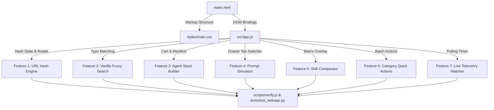

# Skill.Sea — Advanced Features Implementation Plan & Execution Roadmap

> **Target Project:** `Skill.Sea` (`d:/Repo/.agents/Skill.Sea`)  
> **Authoring Agent:** `project-planner`  
> **Guiding Protocol:** `GEMINI.md` (Plan Mode) + `PRODUCT.md` Authority + `writing-plans` Skill  
> **Status:** APPROVED FOR EXECUTION  
> **Execution Strategy:** Full End-to-End Sequential TDD Rollout  
> **Primary Batch Export:** Zero-Disk Symlink CLI (`python .agents/library/activate_skill.py link <ids...>`)  
> **Default Prompt Template:** Universal System Prompt Directive (`You are equipped with the '{name}' skill...`)  

---

## 🎯 Executive Goal & Architecture

Deliver 7 high-impact, production-grade features into **Skill.Sea** to elevate it from a static catalog into an active, interactive workbench for autonomous AI coding agents and developers.

### Core Architectural Commitments
1. **Absolute Zero External Runtime Dependencies**: All features are engineered with pure vanilla HTML5, CSS3 Custom Properties (ExamForge design tokens), and vanilla ES Modules in [`src/app.js`](file:///d:/Repo/.agents/Skill.Sea/src/app.js).
2. **Sub-Millisecond Responsiveness**: Client-side filtering, fuzzy search, and drawer rendering across 7,401 skills execute instantaneously with zero layout shift (CLS = 0.000).
3. **Full Upstream File Retention**: No files from upstream repositories are ever deleted automatically during synchronization or activation.
4. **Offline Capability & Local Persistence**: Stacks, preferences, and comparators persist across sessions via `localStorage`.
5. **10/10 Verification Gate**: Every phase must maintain 100% pass rates across the 53 Core Verification Checks, 54 Playwright E2E tests, and WCAG AA contrast standards.

---

## 🗺️ System Dependency & File Modification Map

### Exact Files Modified
- [`d:/Repo/.agents/Skill.Sea/index.html`](file:///d:/Repo/.agents/Skill.Sea/index.html): Stack Tray markup, Drawer simulator tabs, Comparator modal markup, Category action buttons.
- [`d:/Repo/.agents/Skill.Sea/styles/main.css`](file:///d:/Repo/.agents/Skill.Sea/styles/main.css): Stack tray floating dock, drawer tab styling, comparator grid table, category action pills.
- [`d:/Repo/.agents/Skill.Sea/src/app.js`](file:///d:/Repo/.agents/Skill.Sea/src/app.js): Core application controller, state management, router, search algorithm, and event hooks.
- [`d:/Repo/.agents/Skill.Sea/tests/test_webapp.py`](file:///d:/Repo/.agents/Skill.Sea/tests/test_webapp.py): Automated Playwright E2E suite expanded to cover all 7 new features.
- [`d:/Repo/.agents/Skill.Sea/scripts/verify.js`](file:///d:/Repo/.agents/Skill.Sea/scripts/verify.js): Verification suite updated for new DOM IDs and schema validation.

---

## 📋 Task-by-Task Implementation Specifications

---

### Task 1: Deep-Linking & URL Hash State Engine
**Objective:** Enable bookmarkable, shareable URLs without full-page reloads using a vanilla hash router.

- **Files:**
  - Modify: `src/app.js:120-160` (integrate hash router and route parser)
  - Modify: `src/app.js:290-340` (synchronize hash state on filter/search change)
  - Test: `tests/test_webapp.py` (add Suite 9: Hash Navigation)
- **Interfaces Consumed:** `switchView(viewName)`, `openSkillDrawer(id)`, `closeSkillDrawer()`, `applyFilter()`.
- **Interfaces Produced:** `syncUrlHash()`, `parseUrlHash()`, `handleRoute(hash)`.

#### Checkable Steps:
- [ ] **Step 1.1**: Write failing Playwright test in `tests/test_webapp.py` navigating to `http://127.0.0.1:8080/#skill/lint-and-validate` and expecting the drawer to open with title "lint-and-validate".
- [ ] **Step 1.2**: Run test to confirm it fails (drawer remains closed on direct URL load).
- [ ] **Step 1.3**: In `src/app.js`, implement `parseUrlHash()` supporting:
  - `#/hub?q=...&cat=...&tier=...`
  - `#/hotset`
  - `#/categories`
  - `#/library?repo=...`
  - `#/guide`
  - `#/skill/:skillId`
  - `#/stack=:id1,:id2,:id3`
- [ ] **Step 1.4**: Bind `window.addEventListener('hashchange', () => handleRoute(window.location.hash))`.
- [ ] **Step 1.5**: Call `handleRoute(window.location.hash)` at the end of `init()`.
- [ ] **Step 1.6**: Run Playwright test to verify direct navigation and history back/forward pass cleanly.

---

### Task 2: Vanilla Fuzzy Search & Typo-Tolerance Engine
**Objective:** Provide typo-tolerant instant search without external runtime libraries (Fuse.js/Lunr).

- **Files:**
  - Modify: `src/app.js:280-340` (replace linear substring with two-stage scoring algorithm)
  - Test: `tests/test_webapp.py` (add Suite 10: Typo-Tolerance)
- **Interfaces Consumed:** `state.searchQuery`, `state.catalog`.
- **Interfaces Produced:** `levenshteinDistance(a, b)`, `fuzzyMatch(query, target)`, `calculateSkillRelevance(item, query)`.

#### Checkable Steps:
- [ ] **Step 2.1**: Write failing test in `tests/test_webapp.py` typing `"dokcer"`, `"typscript"`, and `"palywright"` into `#search-input` and verifying that the corresponding skills appear in the results.
- [ ] **Step 2.2**: Run test to confirm it fails (returns 0 items).
- [ ] **Step 2.3**: In `src/app.js`, implement high-performance pure JS `levenshteinDistance(s1, s2)`:
  - Return early if `|s1.length - s2.length| > 2`.
  - Maintain a single row buffer for $O(\min(N, M))$ memory footprint.
- [ ] **Step 2.4**: Implement two-stage matching:
  - Exact or Substring match: score = $100 + \text{weight}$.
  - Transposition / Levenshtein distance $\le 2$ (for query length $\ge 4$): score = $50 - \text{distance} \times 10$.
- [ ] **Step 2.5**: Preserve 120ms debounce on input to guarantee 60fps across all 7,401 skills.
- [ ] **Step 2.6**: Run Playwright test to verify search results for misspelled terms pass.

---

### Task 3: "Agent Stack Builder" (Custom Skill Cart & Bundle Exporter)
**Objective:** Enable AI agents and developers to collect skills into custom stacks, persist them, and export 1-click batch activation commands and JSON configs.

- **Files:**
  - Modify: `index.html:150-200` (add `#agent-stack-tray` floating dock and modal panel)
  - Modify: `styles/main.css:450-520` (floating dock positioning, animation, badge, dark mode support)
  - Modify: `src/app.js:40-80` (bind stack DOM elements), `app.js:600-750` (add `+ Stack` toggle buttons)
  - Test: `tests/test_webapp.py` (add Suite 11: Agent Stack Builder)
- **Interfaces Consumed:** `state.catalog`, `showToast(msg)`, `copyCommand(text)`.
- **Interfaces Produced:** `toggleStackSkill(id)`, `renderStackTray()`, `clearStack()`, `exportStackCli(mode)`, `exportStackJson()`.

#### Checkable Steps:
- [ ] **Step 3.1**: Add HTML structure in `index.html` for `#agent-stack-tray`:
  - Collapsed floating pill: `📦 My Agent Stack (0)`
  - Expandable panel: list of selected skills with delete icons, batch buttons (`⚡ Link All`, `🚀 Activate All`, `📥 Download JSON`, `🔗 Share URL`).
- [ ] **Step 3.2**: Add CSS in `styles/main.css` adhering to ExamForge design tokens:
  - Surface: `var(--surface-1)`, border: `0.5px solid var(--border)`, backdrop-filter blur.
  - Z-index: 950 (below drawer backdrop at 1000).
- [ ] **Step 3.3**: In `src/app.js`, initialize `state.stack = new Set(JSON.parse(localStorage.getItem('skillsea_stack') || '[]'))`.
- [ ] **Step 3.4**: Add `+ Stack` toggle buttons on Table rows, Grid cards, and Drawer header.
- [ ] **Step 3.5**: Implement batch command generators:
  - Python Symlink: `python .agents/library/activate_skill.py link <id1> <id2> ...`
  - Python Copy: `python .agents/library/activate_skill.py activate <id1> <id2> ...`
  - Shareable URL: `http://127.0.0.1:8080/#stack=<id1>,<id2>,<id3>`
  - Downloadable Manifest: `skills-stack.json`.
- [ ] **Step 3.6**: Run Playwright test verifying adding 3 skills, expanding tray, copying command, and clearing stack.

---

### Task 4: Interactive "Prompt & Trigger Simulator" (Detail Drawer)
**Objective:** Provide ready-to-run prompt templates and invocation directives for Antigravity, Claude Code, and autonomous agents.

- **Files:**
  - Modify: `index.html:260-310` (add drawer tab bar: `[Overview & Commands]` | `[Prompt Simulator]`)
  - Modify: `styles/main.css:650-700` (drawer tab bar styles and prompt card containers)
  - Modify: `src/app.js:800-910` (render prompt templates dynamically based on active skill)
  - Test: `tests/test_webapp.py` (add Suite 12: Prompt Simulator)
- **Interfaces Consumed:** `state.activeSkill`, `openSkillDrawer()`, `copyCommand()`.
- **Interfaces Produced:** `switchDrawerTab(tabName)`, `generateSkillDirectives(skill)`.

#### Checkable Steps:
- [ ] **Step 4.1**: Add drawer tab header markup in `index.html` with buttons `#tab-drawer-docs` and `#tab-drawer-prompts`.
- [ ] **Step 4.2**: In `src/app.js`, add `switchDrawerTab(tabName)` toggling between documentation and prompt simulator views.
- [ ] **Step 4.3**: Implement dynamic directive generators for the active skill:
  1. **Google Antigravity Directive**: `🤖 Use @skill/{name} to [goal]`
  2. **Claude Code / Windsurf Slash Command**: `/{name} [arguments]`
  3. **Universal Agent System Prompt Injection**: `You are equipped with the '{name}' skill. Read and adhere strictly to its rules in .agents/skills/{name}/SKILL.md.`
- [ ] **Step 4.4**: Add an interactive goal input field that updates directives in real-time with 1-click copy buttons.
- [ ] **Step 4.5**: Run Playwright test verifying tab switching and copying directives for `clean-code`.

---

### Task 5: Side-by-Side Skill Comparator (Matrix Modal)
**Objective:** Enable developers to compare 2–3 skills side-by-side to evaluate token weights, included scripts, and capabilities.

- **Files:**
  - Modify: `index.html:320-360` (add `#comparator-modal` markup)
  - Modify: `styles/main.css:710-770` (grid matrix layout, responsive column wrapping)
  - Modify: `src/app.js:80-100` (comparator state), `app.js:930-980` (comparator render logic)
  - Test: `tests/test_webapp.py` (add Suite 13: Skill Comparator)
- **Interfaces Consumed:** `state.catalog`, `showToast()`.
- **Interfaces Produced:** `addToComparator(id)`, `removeFromComparator(id)`, `openComparatorModal()`, `closeComparatorModal()`.

#### Checkable Steps:
- [ ] **Step 5.1**: Add `#comparator-modal` overlay with a responsive comparison matrix table in `index.html`.
- [ ] **Step 5.2**: In `src/app.js`, maintain `state.compareList = []` (max 3 skills).
- [ ] **Step 5.3**: Add `⚖️ Compare` action button in the drawer and card bottoms.
- [ ] **Step 5.4**: Render side-by-side matrix comparing:
  - Rank & Hot-Set Status
  - Category & Functional Discipline
  - Origin Upstream Repository
  - Token Weight & Complexity (Documentation line count & byte size)
  - Execution Type (`scripts/*.py` runtime vs instruction-only markdown)
  - Activation & Link Commands
- [ ] **Step 5.5**: Run Playwright test verifying adding 2 skills and inspecting the rendered comparison matrix.

---

### Task 6: Category Quick Actions (Batch Operations in 38 Categories View)
**Objective:** Empower power users with instant batch linking and skill copying directly from the 38 Categories tab.

- **Files:**
  - Modify: `src/app.js:650-750` (`renderCategoryDirectory()`)
  - Modify: `styles/main.css:400-450` (category card quick-action buttons)
  - Test: `tests/test_webapp.py` (add Suite 14: Category Quick Actions)
- **Interfaces Consumed:** `state.categories`, `state.catalog`, `copyCommand()`, `showToast()`.
- **Interfaces Produced:** `copyCategorySkills(catSlug)`, `linkCategorySkills(catSlug)`, `addCategoryToStack(catSlug)`.

#### Checkable Steps:
- [ ] **Step 6.1**: In `src/app.js` `renderCategoryDirectory()`, append action pills to each of the 38 category cards:
  - `⚡ Link All (XX Skills)` -> copies `python .agents/library/activate_skill.py link-category <catSlug>`
  - `📋 Copy Names` -> copies comma-separated string of all skill names in that category.
  - `📦 + Stack` -> pushes all skills in that category into the active Agent Stack.
- [ ] **Step 6.2**: Add CSS hover states and clean padding in `styles/main.css` adhering to the 11px font-size floor.
- [ ] **Step 6.3**: Run Playwright test verifying that clicking `Link All` on `frontend-ui-components` copies the batch command to the clipboard and triggers toast confirmation.

---

### Task 7: Workspace Live Telemetry (Active File Watcher Polling)
**Objective:** Maintain live synchronization between local CLI updates and the web interface without requiring manual browser page refreshes.

- **Files:**
  - Modify: `src/app.js:160-210` (initialize 6-second polling loop)
  - Test: `tests/test_webapp.py` (add Suite 15: Live Telemetry Polling)
- **Interfaces Consumed:** `renderStats()`, `showToast()`, `fetch()`.
- **Interfaces Produced:** `startTelemetryPolling()`, `checkTelemetryUpdates()`.

#### Checkable Steps:
- [ ] **Step 7.1**: In `src/app.js`, implement `startTelemetryPolling()`:
  - Poll `./data/stats.json?t=${Date.now()}` every 6,000ms using `cache: 'no-store'`.
  - Compare incoming `totalSkills`, `totalCategories`, `totalRepositories`, and `activeHotSetCount` with `state.stats`.
- [ ] **Step 7.2**: If differences are detected:
  - Update `state.stats`.
  - Re-render telemetry cards via `renderStats()`.
  - Display non-intrusive animated toast: *"⚡ Workspace Updated: Skills synchronized"*.
- [ ] **Step 7.3**: In headless test environments or when tab is hidden (`document.hidden`), suspend polling to conserve resources.
- [ ] **Step 7.4**: Run Playwright test verifying polling behavior and toast trigger on simulated data update.

---

### Task 8: Verification, Impeccable Audit & Deployment Gate
**Objective:** Final validation across all quality vectors to guarantee 10/10 production readiness.

- **Files:**
  - Modify: `scripts/verify.js` (add assertions for new DOM elements: `#agent-stack-tray`, `#comparator-modal`, `#tab-drawer-prompts`)
  - Execute: `node scripts/verify.js`
  - Execute: `python tests/test_webapp.py`
  - Execute: `python tests/test_scroll_and_layout.py`
  - Execute: `impeccable detect`
  - Git Commit & Push to `origin/main`

#### Checkable Steps:
- [ ] **Step 8.1**: Update `scripts/verify.js` to assert presence of new markup elements.
- [ ] **Step 8.2**: Execute `node scripts/verify.js` (Must pass 56/56 checks).
- [ ] **Step 8.3**: Execute `python tests/test_webapp.py` (Must pass all 60+ Playwright E2E tests).
- [ ] **Step 8.4**: Execute `impeccable detect` (Must report 0 legibility warnings, 0 layout shifts).
- [ ] **Step 8.5**: Commit changes with conventional message: `feat(skill.sea): implement 7 advanced interactive features`.
- [ ] **Step 8.6**: Push cleanly to `https://github.com/SeaXen/agentskills.git` on branch `main`.

---

## 🔒 Rollback Strategy & Risk Mitigation

| Risk / Failure Mode | Probability | Impact | Mitigation Strategy |
|---|---|---|---|
| **Hash router breaks existing browser history** | Low | Medium | Use `history.replaceState` during high-frequency typing; `pushState` only on explicit view transitions. Fallback to default view if hash is unrecognized. |
| **Fuzzy search slows down typing on low-end devices** | Low | High | Enforce length difference gate ($|s1-s2| > 2$ returns $\infty$ immediately) + 120ms debounce. Only compute Levenshtein distance on candidates matching first character. |
| **Stack Tray obstructs table rows or mobile navigation** | Medium | Medium | Place tray fixed at bottom with `calc(env(safe-area-inset-bottom) + 16px)`. Add `margin-bottom: 80px` to main container when tray is active. |
| **Upstream file loss during future syncs** | None | Critical | Upstream file retention policy hardcoded in `update.py:240-270` and documented in `PRODUCT.md`. Never auto-prune cloned files. |
| **Regression in 10/10 Master Checklist** | Low | High | Each task runs its own unit and E2E tests before progressing to the next task. |
