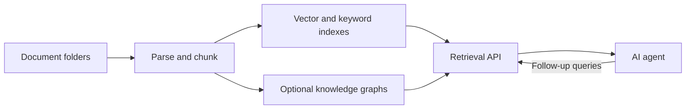

# Carrel

English | [中文](README.zh-CN.md)

[](https://github.com/FengZhenfei/carrel/actions/workflows/tests.yml) [](LICENSE)

**Ontology-Augmented Generation for AI agents.**

Carrel is a self-hosted knowledge base for AI agents. It automates document
parsing, indexing, and retrieval, with optional knowledge graphs. Agents use
its API to retrieve source passages, images, and related facts, then generate
their own answers.

Use it to give an agent access to a collection of product documents, research,
contracts, meeting notes, or other files that change over time. A web console
manages knowledge bases, models, and processing tasks. A bundled
[search skill](skills/carrel-search/SKILL.md) connects agents such as Claude
Code and Codex to the retrieval service.

**[0.4.1 general retrieval benchmarks and codebase capabilities](docs/evaluations/retrieval-0.4.1.md)** · [Full 0.4.0 capability evaluation](docs/evaluations/capability-evaluations-0.4.0.md)

[Features](#features) · [Evaluation](#capability-evaluation) · [Design](#design) · [Quick start](#quick-start) · [Agent integration](#agent-integration) · [Documentation](#documentation)

## Features

[0.4.2 changes and upgrade steps](docs/releases/0.4.2.md) — Light and Standard editions, container deployment, and independent model configuration.

- **Document parsing:** PDF, Word, PowerPoint, spreadsheets, images, HTML,
  Markdown, notebooks, source code, and workflow files, with processing suited
  to each format. [Format details](docs/architecture.md#ingestion).
- **Automatic updates:** scan for file changes, update indexes, and maintain
  enabled knowledge graphs through scheduled tasks.
- **Hybrid retrieval:** combine vector, keyword, graph, and visual search,
  with automatic knowledge-base selection and optional text/image reranking
  with rank fusion.
- **Knowledge graphs:** extract entity types, relationships, and facts from
  your documents; retain sources, time information, and conflict indicators,
  compare graph versions, and apply reviewed, evidence-scoped corrections.
- **Agent access:** search through an API, fetch surrounding text or original
  images, and follow graph relationships when more evidence is needed.
- **Web console:** configure processing, inspect chunks and graphs, track
  tasks, and manage services. Available in English and Chinese.

## Capability evaluation

Across 275 text queries, 0.4.1 reached **93.45%** evidence Hit@5 and **0.8141** MRR@10. In a separate study of 24 code questions, Haiku answered **13** completely from the first response and **23** with Skill follow-up. [0.4.1 evaluation](docs/evaluations/retrieval-0.4.1.md)

The full 0.4.0 evaluation also covers graph rebuild stability, time-scoped evidence, conflicts and ontology governance. [Full 0.4.0 technical report](docs/evaluations/capability-evaluations-0.4.0.md)

## How it works



Carrel uses MinerU and native parsers for ingestion. Standard uses Qdrant,
OpenSearch and Neo4j; Light uses embedded LanceDB and DuckDB. SQLite tracks files
and tasks in both editions. Model services run independently, locally or through
compatible hosted endpoints.
See [Architecture](docs/architecture.md) for the pipeline and retrieval design.

## Design

Carrel provides general knowledge storage, retrieval, and evidence interfaces.
Entities, relationships, and facts retain sources, time information, and
conflicts so agents can check and use them alongside the original documents.
Default retrieval retains historical and future source claims. An explicit
time query selects the relevant evidence; reviewed corrections record which
sources and identities the decision applies to.
**The Agent Loop plugin is in development and not yet implemented.** It is
intended to use these interfaces to continuously learn an enterprise ontology,
seek clarification from relevant people, and maintain correction rules.

Routine graph updates merge new and changed content incrementally. Configured
time or change thresholds trigger full rebuilds, balancing update cost with
overall consistency. Parsing, indexing, and graph construction are maintained
separately: rebuilding a graph can reuse parsed content and chunks while
preserving RAG indexes.

## Requirements

- Docker with Compose v2. Python and background scheduling run inside the application container.
- A text embedding endpoint; a vision-language endpoint for image descriptions;
  and a chat model for knowledge graph construction, if enabled.
- An NVIDIA GPU and NVIDIA Container Toolkit for GPU parsing. CPU parsing is
  also supported. Resource needs depend on the parser and collection size.

| Platform | Deployment |
|---|---|
| Linux with NVIDIA GPU | GPU parsing with NVIDIA Container Toolkit; container scheduling |
| Linux without GPU | CPU parsing; connect to model services on another host or a provider |
| macOS with Docker Desktop | CPU parsing and application containers, including scheduling |
| Windows | Use WSL2; native Windows deployment is not supported |

[Example setup](docs/example-setup.md) describes the author's installation
on an NVIDIA DGX Spark and some lighter alternatives.

## Quick start

### 1. Deploy the services

```bash
git clone https://github.com/FengZhenfei/carrel.git
cd carrel
./deploy.sh --standard --build
# Or use embedded storage:
# ./deploy.sh --light --build
```

The optional script prepares Compose configuration and starts the application,
background scheduler and selected dependencies. You can also use Compose directly.
First startup downloads MinerU parser assets. See [Container deployment](deployment/compose/README.md).

### 2. Configure model endpoints

Choose **Standard** for Qdrant, OpenSearch and Neo4j, or **Light** for embedded
LanceDB and DuckDB. The edition is fixed for that deployment directory. Both
include MinerU; Light has no database containers. See [Storage editions](docs/storage.md).

In **System settings**, configure LLM, Embedding and Reranker endpoints, model IDs
and API keys. Register a vision-capable LLM and select it as the **Multimodal model**
for each knowledge base. Images, charts and table review share that selection.
Models can run on your own machines or hosted platforms. Carrel does not start
these model services or download their weights. See [Model configuration](docs/configuration.md#model-endpoints).

### 3. Add documents

Open the console at **http://127.0.0.1:9800**. Put documents in
`data/runtime/mirror/<folder>/`, then enable that folder in the console. Each
enabled folder becomes a knowledge base; scheduled tasks process its files.

For a knowledge graph, register a chat model with its **Max Input** in the console, select it in the
knowledge-base settings, and enable graph building. Check service health and
task progress in the console before making your first query.

## Agent integration

Install the bundled [carrel-search skill](skills/carrel-search/SKILL.md)
in your agent, or call the API directly:

```bash
curl -sS http://127.0.0.1:9810/search \
  -H 'Content-Type: application/json' \
  -d '{"question": "What are the delivery and acceptance requirements?", "top_k": 8}'
```

If you set `KB_SEARCH_TOKEN`, add an `Authorization: Bearer …` header.
For a remote agent,
configure `CARREL_SEARCH_BASE_URL` and `CARREL_SEARCH_TOKEN` in its environment.

Responses include source passages and, when available, graph evidence and
image information. Agents can request more context, inspect images, and
follow relationships before answering. See [Retrieval and API](docs/retrieval.md)
for authentication, response status, and citations.

## Documentation

| Guide | Contents |
|---|---|
| [Configuration](docs/configuration.md) | Model endpoints, folders, per-base settings, and access control |
| [Architecture](docs/architecture.md) | Parsing, graph construction, retrieval, and code layout |
| [Retrieval and API](docs/retrieval.md) | Agent setup, endpoints, evidence status, and evaluation |
| [Retrieval and codebase evaluation (0.4.1)](docs/evaluations/retrieval-0.4.1.md) | Document retrieval, page-image location, Skill follow-up and cross-file code analysis |
| [Capability evaluation (0.4.0)](docs/evaluations/capability-evaluations-0.4.0.md) | Full technical report: retrieval, answers, temporal evidence, conflicts, ontology, rebuild stability, latency, and token usage |
| [Operations and development](docs/operations.md) | Console, CLI, scheduling, troubleshooting, and tests |
| [Test scope](docs/testing.md) | Shared regression contracts, deployment-specific checks, and live evaluations |
| [Example setup](docs/example-setup.md) | The author's installation on a DGX Spark, a Mac that syncs the documents, and lighter alternatives |
| [Docker Compose](deployment/compose/README.md) | Infrastructure, model weights, and container settings |
| [Container deployment](deployment/compose/README.md) | Images, scheduling, persistent data and updates |
| [systemd](deployment/systemd/README.md) | Native/source installation |

## Data and access

The console binds to localhost by default. For LAN access, set both
`KB_WEB_HOST` and `KB_WEB_TOKEN`. Configure `KB_SEARCH_TOKEN` before using
protected search endpoints remotely. The stores and model servers listen on
loopback only, which keeps other machines out but not web pages opened in a
browser on the same host, so avoid browsing the web there.

Documents and images are sent to the model endpoints you configure. Local
endpoints keep model processing within your own infrastructure.
See [Access and data handling](docs/configuration.md#access-and-data-handling).

## License

Carrel is licensed under [MIT](LICENSE). Dependencies and model weights have
their own licenses; see [Third-party notices](NOTICE.md). Original-resolution
PDF image retrieval uses an optional dependency installed with
`./deploy.sh --with-pdf-images`; without it, retrieval uses cached images.
