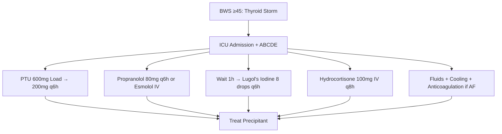
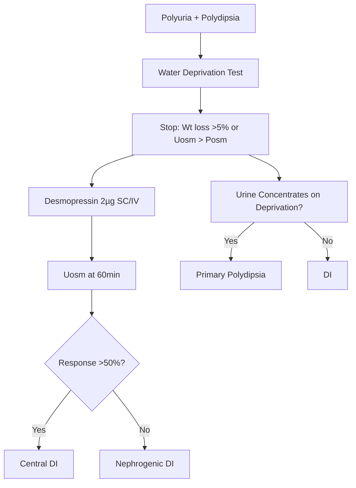
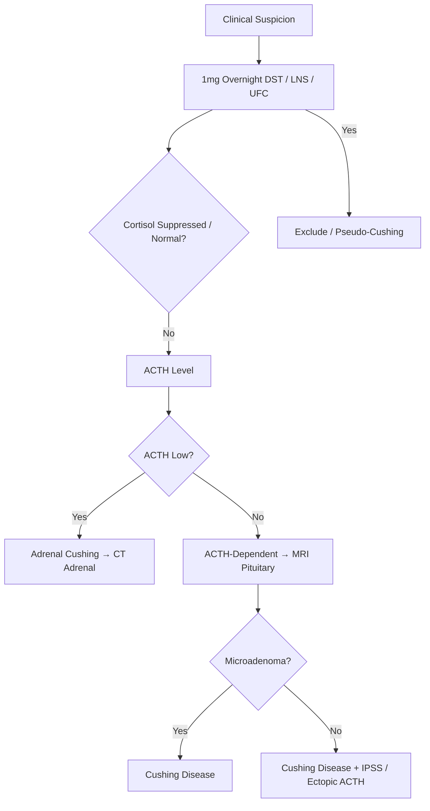
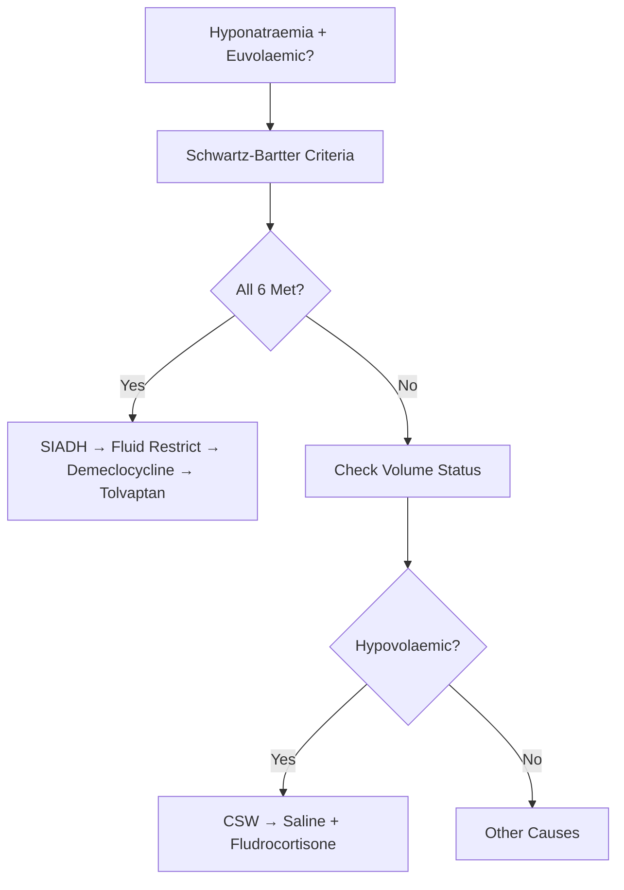

# Endocrinology Scoring Systems & Key Algorithms Reference

## Scoring Systems

### Thyroid
| Score | Purpose | Parameters | Thresholds |
|-------|---------|------------|------------|
| **Burch-Wartofsky Score** | Thyroid Storm Diagnosis | Temp, CNS, GI, Cardiac, Precipitant | ≥45 = Diagnostic; 25-44 = Probable; <25 = Unlikely |
| **ATA Risk Stratification** | DTC Recurrence Risk | Invasion, Nodes, Tg, RAI uptake, Histology | Low <5%; Intermediate 5-20%; High >20% |
| **TNM Staging (AJCC 8th)** | DTC Prognosis | T (size/extension), N (nodes), M (mets) | Age <55: Stage I/II only |

### Adrenal
| Score | Purpose | Parameters | Thresholds |
|-------|---------|------------|------------|
| **KDIGO CKD-MBD Targets** | SHPT Management | PTH, Ca, Phos, Ca×P, 25-OH Vit D | PTH 2-9x ULN; Ca 2.1-2.5; Phos 0.8-1.5; Ca×P <4.5 |
| **ALDO/Renin Ratio (ARR)** | Primary Aldosteronism Screening | Aldo (pmol/L) / Renin (mIU/L) | >70 (or >30 + Aldo >400) = Positive |
| **AVS Selectivity Index** | AVS Technical Success | Adrenal Vein Cortisol / IVC Cortisol | ≥2-3 (with Cosyntropin) = Selective |
| **AVS Lateralisation Index** | Unilateral vs Bilateral | High-side A/C ÷ Low-side A/C | ≥4 (with Cosyn) = Unilateral |

### Pituitary
| Score | Purpose | Parameters | Thresholds |
|-------|---------|------------|------------|
| **RET Codon Risk (ATA)** | MEN2 Prophylactic Thyroidectomy | RET Codon Mutation | Level A (M918T): <1yr; Level B (634): 5yr; Level C: 5-10yr; Level D: 10-20yr |
| **IOPTH (Miami Criterion)** | Parathyroidectomy Cure Prediction | PTH Drop at 10min post-excision | >50% drop from peak = Cure |
| **Water Deprivation Test** | DI vs SIADH vs Psychogenic Polydipsia | Urine/Serum Osmolality, Post-DDAVP response | Central DI: No concentrate on depr, >50% rise post-DDAVP |

### Calcium & Bone
| Score | Purpose | Parameters | Thresholds |
|-------|---------|------------|------------|
| **Corrected Calcium** | Albumin Adjustment | Ca_corr = Measured Ca + 0.02×(40-Albumin g/L) | Normal 2.15-2.55 mmol/L |
| **FRAX** | 10yr Fracture Risk | Age, Sex, BMI, Prior Fx, Parents, Smoking, Glucocorticoids, RA, Alcohol, BMD | NOGG: Major ≥7.5-15%, Hip ≥3-4.5% |
| **CCCR (Urine Ca/Cr)** | FHH vs PHPT | (Urine Ca × Plasma Cr) / (Plasma Ca × Urine Cr) | <0.01 = FHH; >0.02 = PHPT |
| **Calcium/Phosphate Product** | Vascular Calcification Risk | Corrected Ca × Phosphate | >4.5 mmol²/L² = High Risk |
| **KDIGO PTH Target** | SHPT in CKD | PTH vs ULN | 2-9x ULN (Avoid <2x = Adynamic Bone) |

### Reproductive
| Score | Purpose | Parameters | Thresholds |
|-------|---------|------------|------------|
| **Rotterdam Criteria** | PCOS Diagnosis | 2/3: Oligo/Anovulation, Hyperandrogenism, PCOM | 2 of 3 required |
| **mFG Score** | Hirsutism | 9 Body Areas (0-4 each) | >8 = Significant |
| **FAI** | Biochemical Hyperandrogenism | (Total T × 100) / SHBG | >5 = Positive |

### Growth
| Score | Purpose | Parameters | Thresholds |
|-------|---------|------------|------------|
| **OGTT GH Suppression** | Acromegaly Diagnosis | GH at 0, 30, 60, 90, 120min post 75g Glucose | Not suppressed <1 µg/L = Acromegaly |

---

## Key Algorithms (Mermaid Flowcharts)

### Thyroid Storm Management


### Water Deprivation Test Interpretation


### Cushing Syndrome Workup


### Hypercalcaemia Differential
```mermaid
flowchart TD
    A[Hypercalcaemia] --> B[PTH Level]
    B --> C{PTH High/Inappropriately Normal?}
    C -->|Yes| D[24h Urine Ca/Cr Ratio]
    D --> E{<0.01?}
    E -->|Yes| F[FHH - No Surgery]
    E -->|No| G[Primary HPT - Surgery]
    C -->|Suppressed| H[PTHrP Level]
    H --> I{PTHrP +?}
    I -->|Yes| J[Humoral HyperCa of Malignancy]
    I -->|No| K[1,25-(OH)2D?]
    K --> L{High?}
    L -->|Yes| M[Granulomatous / Lymphoma]
    L -->|No| N[Vit D Toxicity / Thyrotoxicosis]
```

### SIADH vs CSW


---

## Stream Timeout Prevention Pattern

For notes >8K tokens (~2000 words):
```python
# Split into chunks:
# Chunk 1: Frontmatter + Learning Objectives + Sections 1-4
# Chunk 2: Sections 5-8 (Diagnosis, Differential, Management)
# Chunk 3: Sections 9-14 (Confusions, Mind Map, Pearls, Navigation)
```

Each chunk written via separate `write_file` call with append=False.

---

## Quality Checklist for Endocrinology Notes

- [ ] Frontmatter: all fields complete (tags, davidson_part/chapter, status, priority, exam_relevance, see_also, dates)
- [ ] All 14 sections present (excludes MCQs/SBAs unless requested)
- [ ] Tables have units in column headers
- [ ] Mermaid diagrams use valid syntax (flowchart TD / mindmap)
- [ ] Viva/Pearl questions have key numbers (doses, thresholds, percentages)
- [ ] Local Navigation wiki-links use correct relative paths
- [ ] Cross-links to related topics use `[[...]]` format
- [ ] No placeholder text remaining
- [ ] Stream timeout prevention applied if note large