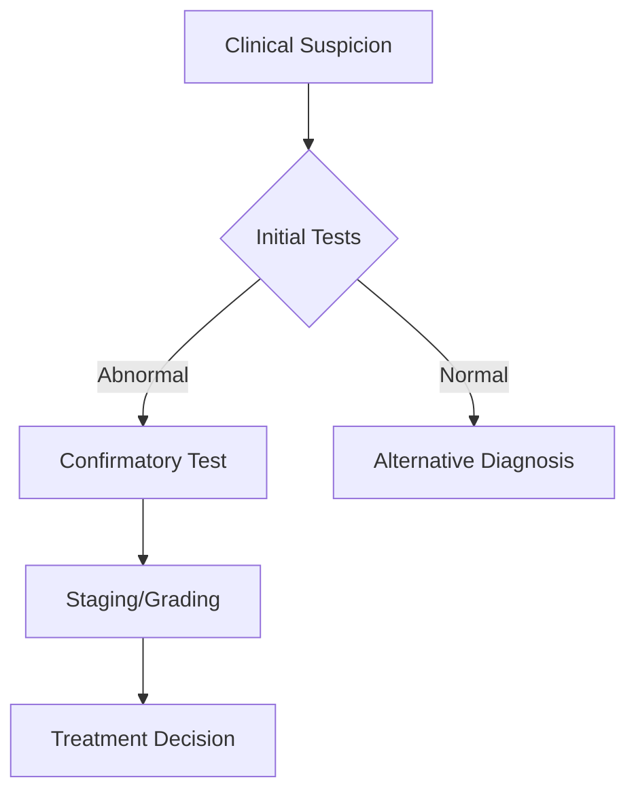
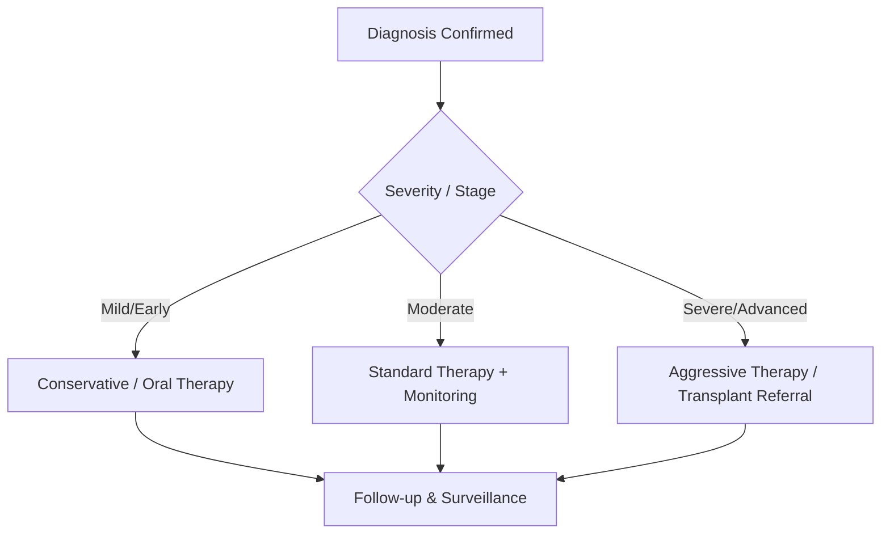
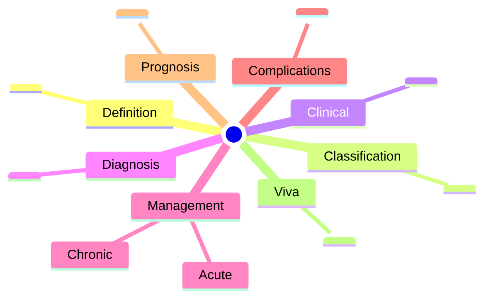

# Hepatology Topic Template

> [!info]
> **Use this template for all hepatology disease-level notes.**
> Copy this file, rename it, and fill in all sections.
> Target: **full-fcps-mrcp-note** status.

---

## Frontmatter (REQUIRED — copy exactly, edit values)

```yaml
---
tags: [medicine, hepatology, davidson, <topic-tag>, fcps, mrcp]
davidson_part: Part 3: Clinical Medicine
davidson_chapter: Chapter 24: Hepatology
status: full-fcps-mrcp-note
priority: HIGH|MEDIUM|LOW
exam_relevance: "FCPS/MRCP High Yield - <one-line summary of why this topic matters for exams>"
see_also: ["<Related Topic 1>", "<Related Topic 2>", "<Related Topic 3>"]
created: YYYY-MM-DD
modified: YYYY-MM-DD
---
```

> **Priority Guide**: HIGH = Core FCPS/MRCP viva topic (ALF, cirrhosis complications, viral hepatitis, HCC); MEDIUM = Important but less frequent (inherited, DILI, benign tumours); LOW = Niche/special situations.

---

## Standard Sections (ALL 13 REQUIRED)

### 1. Learning Objectives
By the end of this note you should be able to:
- [ ] <Objective 1: Recognize/Identify/Diagnose>
- [ ] <Objective 2: Classify/Stage/Grade>
- [ ] <Objective 3: Manage/Treat (acute + chronic)>
- [ ] <Objective 4: Apply scoring systems/algorithms>
- [ ] <Objective 5: Counsel on prevention/surveillance/prognosis>

---

### 2. Definition & Epidemiology (or Pathophysiology)

| Feature | Detail |
|---------|--------|
| **Definition** | <Concise definition> |
| **Incidence/Prevalence** | <UK/global numbers if known> |
| **Peak Age / Sex Ratio** | <Demographics> |
| **Risk Factors** | <Major risk factors> |

> Use **Pathophysiology** subsection if more relevant than Epidemiology (e.g., for genetics, mechanisms).

---

### 3. Clinical Features / Presentation

| Presentation | Frequency | Key Features |
|-------------|-----------|--------------|
| <Symptom 1> | <Common/Rare> | <Details> |
| <Symptom 2> | <Common/Rare> | <Details> |

> Include **Red Flags** and **Atypical Presentations** if high-yield.

---

### 4. Classification / Staging / Grading (TABLE REQUIRED)

| System | Categories | Key Features / Prognosis |
|--------|------------|--------------------------|
| <System 1> | <Categories> | <Details> |
| <System 2> | <Categories> | <Details> |

> Include **scoring systems** (Child-Pugh, MELD, Maddrey, Lille, BCLC, LI-RADS, West Haven, etc.) as separate rows or sub-tables.

---

### 5. Diagnosis & Investigations

| Investigation | Role | Key Details / Findings |
|---------------|------|------------------------|
| <Test 1> | <Screening/Confirmatory/Staging> | <Key values, sensitivity/specificity, patterns> |
| <Test 2> | <Role> | <Details> |

> Include **Mermaid flowchart** for diagnostic algorithm if applicable.



---

### 6. Differential Diagnosis (TABLE REQUIRED)

| Condition | Distinguishing Features |
|-----------|-------------------------|
| <DDx 1> | <Key differentiators: labs, imaging, clinical> |
| <DDx 2> | <Key differentiators> |
| <DDx 3> | <Key differentiators> |

> Focus on **exam-favourite** DDx distinctions (e.g., AIH vs PBC vs PSC, ALF vs ACLF, HCC vs metastases).

---

### 7. Management (TABLE + ALGORITHM)

#### Acute / Inpatient Management

| Step | Intervention | Dose / Details |
|------|--------------|----------------|
| 1 | <Stabilization / ICU> | <Details> |
| 2 | <Specific therapy> | <Dose, duration, monitoring> |
| 3 | <Complication prevention> | <Details> |

#### Chronic / Outpatient Management

| Setting | Intervention | Dose / Monitoring |
|---------|--------------|-------------------|
| <Scenario 1> | <Drug/Intervention> | <Dose, duration, target> |
| <Scenario 2> | <Drug/Intervention> | <Dose, duration, target> |

> Include **Mermaid flowchart** for management algorithm.



---

### 7. FCPS/MRCP High-Yield Summary (BULLET TABLE)

| Topic | Key Points |
|-------|------------|
| <High-yield area 1> | <Must-know facts, numbers, criteria> |
| <High-yield area 2> | <Must-know facts, numbers, criteria> |
| <High-yield area 3> | <Must-know facts, numbers, criteria> |

> **This section is what you review 24h before exam.** Be ruthless — only viva-ready facts.

---

### 8. Viva Questions (MRCP PACES / FCPS)

| Question | Expected Answer |
|----------|-----------------|
| <Question 1: Definition/classification> | <Precise, exam-ready answer with key numbers> |
| <Question 2: Diagnosis/investigation> | <Stepwise approach, key tests, cut-offs> |
| <Question 3: Scoring system/algorithm> | <Components, cut-offs, clinical action> |
| <Question 4: Management (acute/chronic)> | <Drug names, doses, duration, monitoring> |
| <Question 5: Complications/prognosis> | <Key complications, survival, transplant criteria> |
| <Question 6: DDx distinction> | <3-4 key differentiators in table form> |

> **Aim for 6-8 questions** covering: Definition, Classification, Diagnosis, Acute Mgmt, Chronic Mgmt, Complications, DDx.

---

### 9. Confusions & Mnemonics

| Confusion | Clarification |
|-----------|---------------|
| <Common mix-up 1> | <Clear distinction with memory hook> |
| <Common mix-up 2> | <Clear distinction with memory hook> |

**Mnemonic: <NAME>**
- **L**etter = <Expansion with key facts>
- **E**ach letter = <High-yield fact>

> Use standard hepatology mnemonics where established (e.g., **CHILD-PUGH**, **MELD**, **MADDREY**, **LILLE**, **BCLC**, **LI-RADS**, **WEST HAVEN**, **SAAG**, **HVPG**, **FIB-4**, **RUCAM**, **NAFLD**, **AIH**, **PBC**, **PSC**, **HRS**, **HPS**, **ABCD²**, **MELD-NA**, **CLIF-C**, **SOFA**, **APACHE**, **MELD-3**, **MELD-Na**).

---

### 10. Mind Map



---

### 11. One-Page Revision Card

| Domain | Key Points |
|--------|------------|
| **Definition** | <1-liner> |
| **Key Test** | <Diagnostic gold standard + cut-off> |
| **Classification** | <System + key categories> |
| **Acute Mgmt** | <Drug + dose + duration> |
| **Chronic Mgmt** | <Drug + dose + target> |
| **Key Score** | <Name + cut-offs + action> |
| **Complications** | <Top 3 with management> |
| **Prognosis** | <Survival / transplant criteria> |

---

### 12. Spaced Repetition Trackers

| Review Interval | Date Completed | Confidence (1-5) | Notes |
|-----------------|----------------|------------------|-------|
| 24 hours | | | |
| 7 days | | | |
| 15 days | | | |
| 30 days | | | |
| 90 days | | | |

---

### 13. Self-Test Scorecard

| Section | Score /5 | Last Attempt |
|---------|----------|--------------|
| Definition & Epidemiology | | |
| Classification & Staging | | |
| Clinical Features | | |
| Diagnosis & Investigations | | |
| Management (Acute) | | |
| Management (Chronic) | | |
| Complications | | |
| Viva Questions | | |
| DDx Distinctions | | |
| Mnemonics/Algorithms | | |

---

### Local Navigation (REQUIRED — copy exactly, edit links)

- **Parent Heading**: [[../Hepatology|Hepatology]]
- **Chapter Map": [[../Davidson Chapter 24 - Hepatology Hierarchy|Hepatology Hierarchy]]
- **Chapter MOC": [[../Hepatology MOC|Hepatology MOC]]
- **Drug Reference": [[../../Clinical Therapeutics and Good Prescribing|Drugs]]
- **Related**: [[<Related Topic 1>]], [[<Related Topic 2>]], [[<Related Topic 3>]]

---

## Tags
#medicine #hepatology #davidson #template #fcps #mrcp