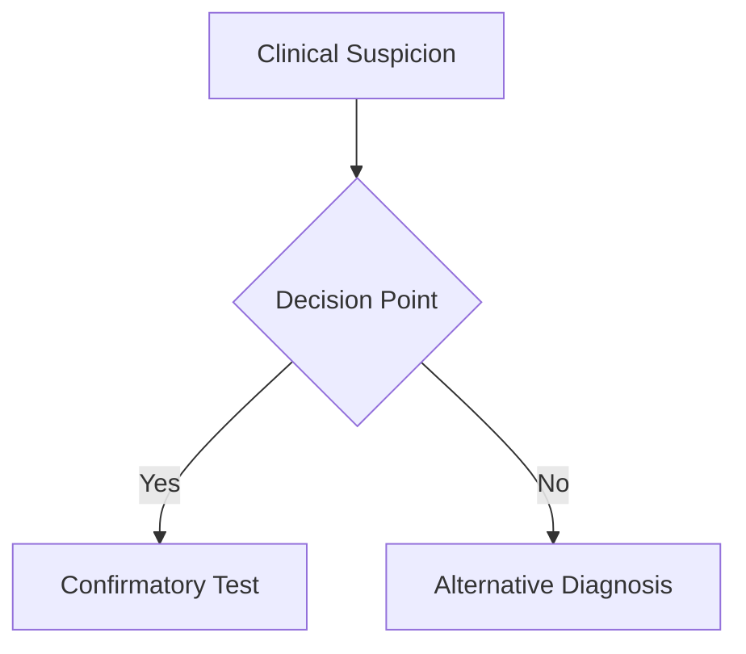
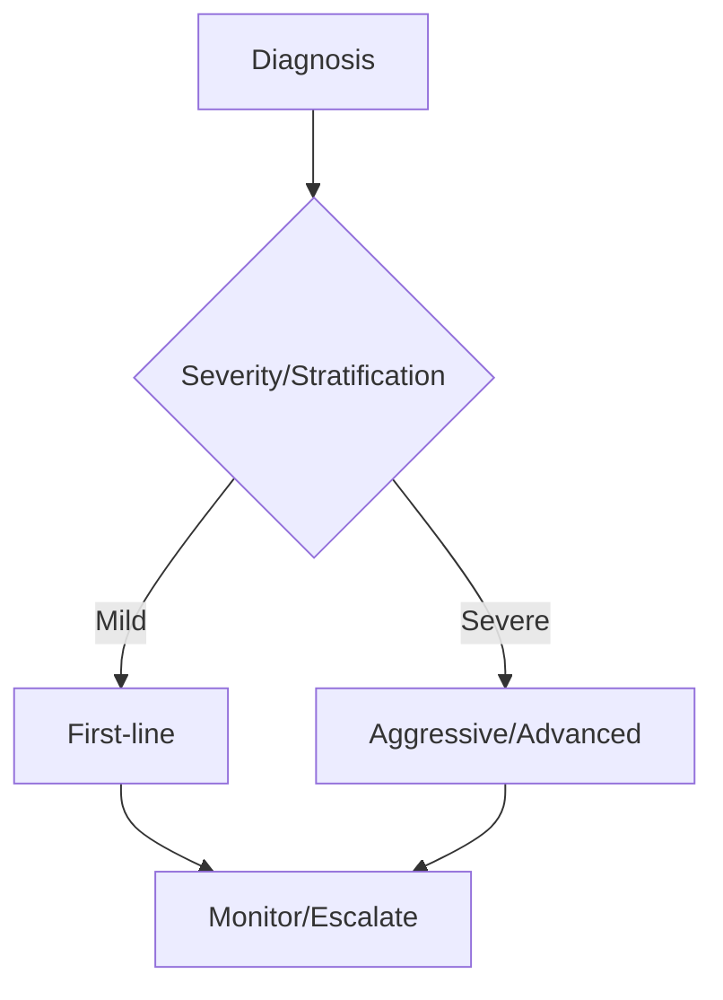
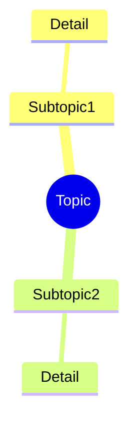

---
# Blank Note Template for FCPS/MRCP Notes

---
tags: [medicine, specialty, davidson, topic, fcps, mrcp]
chapter: [Specialty]
davidson_part: Part [X]: [Part Name]
davidson_chapter: Chapter [XX]: [Chapter Name]
heading: [Heading Name]
topic_group: [Topic Group Name]
topic: [Topic Name]
status: full-fcps-mrcp-note
priority: [critical/high/medium]
cards: [estimated cards]
created: [YYYY-MM-DD]
modified: [YYYY-MM-DD]
exam_relevance: [FCPS, MRCP Part 1, MRCP Part 2, PACES]
see_also:
  - "[[Related Topic 1]]"
  - "[[Related Topic 2]]"
---

# [Topic Name]

> [!tip] **FCPS/MRCP Priority: [CRITICAL/HIGH/MEDIUM]**
> One-sentence summary of why this topic is high-yield for exams.

---

## Learning Objectives
By the end of this note you should be able to:
- [ ] Objective 1 (specific, measurable)
- [ ] Objective 2 (specific, measurable)
- [ ] Objective 3 (specific, measurable)

---

## 1. Definition & Epidemiology

| Feature | Detail |
|---------|--------|
| **Definition** | Concise definition |
| **Incidence** | X/100,000/year |
| **Prevalence** | X% |
| **Peak Onset** | Age range |
| **Sex Ratio** | M:F ratio |
| **Genetics** | Key genes/HLA associations |

---

## 2. Aetiology & Pathophysiology

### Key Pathogenic Features
| Feature | Detail |
|---------|--------|

---

## 3. Clinical Features

| Domain | Features | FCPS/MRCP Pearl |
|--------|----------|-----------------|

> [!critical] **Key Differentiator**
> Brief statement of what distinguishes this from main differentials.

---

## 4. Classification Criteria / Diagnostic Criteria

| Criterion | Detail/Threshold |
|-----------|-----------------|

**Diagnosis Rule**: [Number] of [Total] criteria required + [exclusion/inclusion requirements]

---

## 5. Investigations

| Test | Role | Typical Finding |
|------|------|-----------------|

### Diagnostic Algorithm

---

## 6. Management

### Treatment Algorithm

### Step-by-Step Management

| Step | Intervention | Details |
|------|--------------|---------|

### Drug Details Table

| Drug | Dose | Mechanism | Monitoring | Key Points |
|------|------|-----------|------------|------------|

---

## 6. Complications

| Complication | Frequency | Significance | Management |
|--------------|-----------|--------------|------------|

---

## 7. FCPS/MRCP High-Yield Summary

| Topic | Key Points |
|-------|------------|

---

## 8. Viva Questions (MRCP PACES / FCPS)

| Question | Expected Answer |
|----------|----------------|

---

## 9. Confusions & Mnemonics

| Confusion | Clarification |
|-----------|---------------|

**Mnemonic: [NAME] = "[PHRASE]"**
- **L**etter = **M**eaning

---

## 10. Mind Map

---

## 11. One-Page Revision Card

| Domain | Key Points |
|--------|------------|

---

## 12. Spaced Repetition Trackers

| Review Interval | Date Completed | Confidence (1-5) | Notes |
|-----------------|----------------|------------------|-------|
| 24 hours | | | |
| 7 days | | | |
| 15 days | | | |
| 30 days | | | |
| 90 days | | | |

---

## 13. Self-Test Scorecard

| Section | Score /5 | Last Attempt |
|---------|----------|--------------|

---

## Local Navigation
- **Parent Heading**: [[../[Parent Heading]|[Parent Heading]]]
- **Parent Topic Group**: [[[Parent Topic Group]]]
- **Chapter Map**: [[../Davidson Chapter [XX] - [Chapter Name]|[Chapter Name] Hierarchy]]
- **Chapter MOC**: [[../[Specialty] MOC|[Specialty] MOC]]
- **Drug Reference**: [[../../Clinical Therapeutics and Good Prescribing|Drugs]]
- **Related**: [[Related Topic 1]] · [[Related Topic 2]]