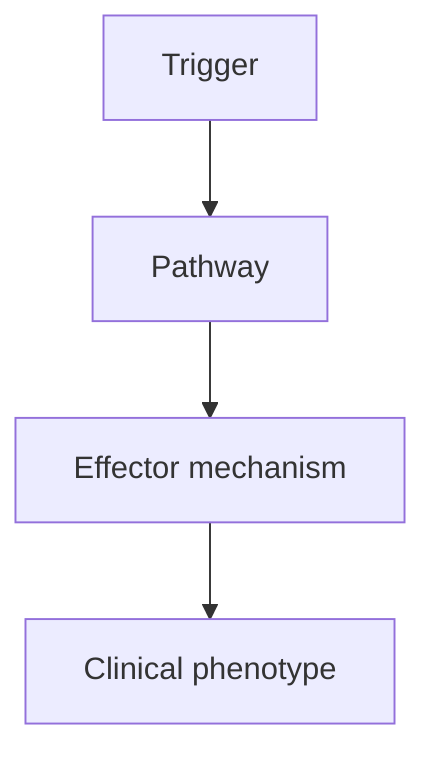
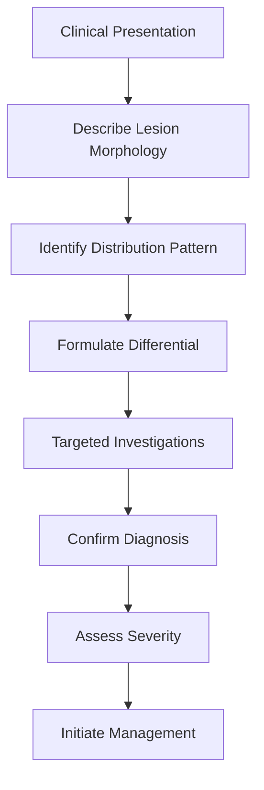
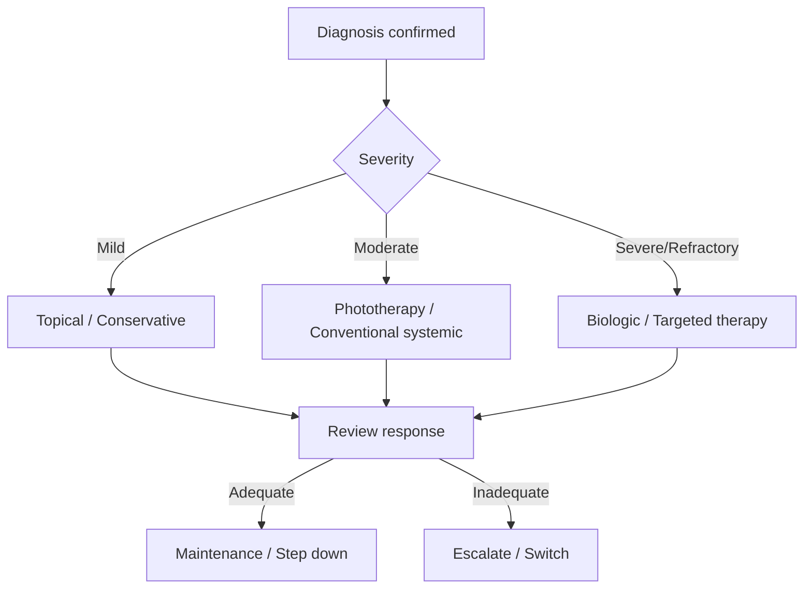
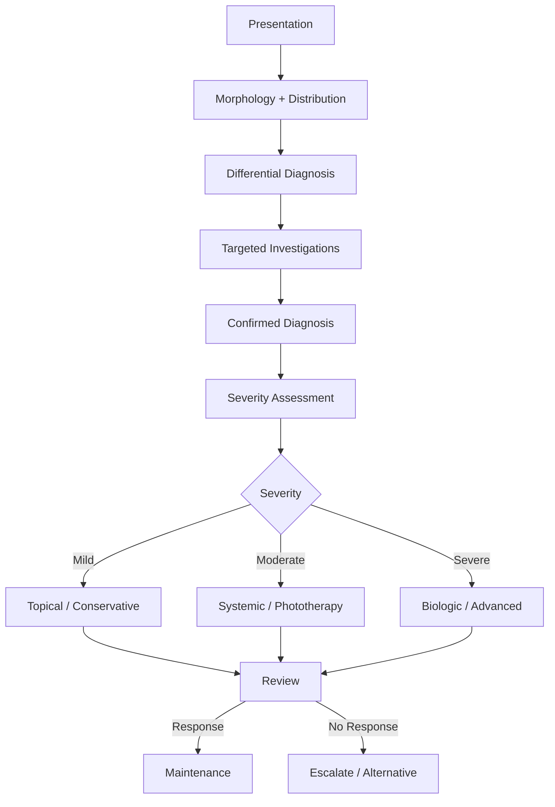

# {{Dermatology Topic}}

Related: [[Rash Approach]], [[Drug Eruptions]], [[Autoimmune Skin Disease]], [[Psoriasis]], [[Atopic Dermatitis]], [[Skin Cancer]], [[Bullous Disease]], [[Cutaneous Vasculitis]]

> [!tip]
> Focus on lesion morphology, rash patterns, dermatologic emergencies, and systemic links.

> [!tip]
> Add primary-lesion description, distribution patterns, biopsy clues, and emergency rash red flags.

## Learning Objectives
- [ ] Define the condition and classify its variants
- [ ] Describe epidemiology and risk factors
- [ ] Explain pathophysiology and molecular mechanisms
- [ ] List clinical features (morphology, distribution, course)
- [ ] Outline diagnostic approach and investigations
- [ ] Differentiate from key mimics (differential diagnosis table)
- [ ] Detail management algorithm (stepwise, evidence-based)
- [ ] Identify complications, red flags, and referral criteria
- [ ] Recall FCPS/MRCP high-yield facts, doses, durations
- [ ] Answer viva questions confidently
- [ ] Recognise common confusions and apply mnemonics

---

## 1. Definition / Epidemiology / Classification

### Definition

### Epidemiology
- **Incidence/Prevalence:**
- **Age/Peak onset:**
- **Sex ratio:**
- **Geographic/ethnic variation:**

### Classification
| Variant | Key Features | Prognosis |
|---------|-------------|-----------|
| | | |

---

## 2. Aetiology / Pathophysiology

### Aetiology
- **Genetic:**
- **Environmental:**
- **Immunological:**
- **Infectious triggers:**
- **Drug-induced:**

### Pathophysiology


### Molecular/Genetic Basis
- **Key genes/mutations:**
- **HLA associations:**
- **Cytokine pathways:**
- **Autoantibodies:**

---

## 3. Clinical Features

### History
- **Onset/Duration:**
- **Progression:**
- **Symptoms (pruritus, pain, burning):**
- **Triggers/Exacerbating factors:**
- **Systemic symptoms:**
- **Drug history:**
- **Family history:**
- **Atopic history:**

### Examination (Lesion Morphology)
| Feature | Description |
|---------|-------------|
| **Primary lesion** | Macule, papule, plaque, nodule, vesicle, bulla, pustule, wheal |
| **Secondary changes** | Scale, crust, erosion, ulcer, lichenification, excoriation |
| **Colour** | Erythematous, violaceous, hyperpigmented, hypopigmented |
| **Shape** | Annular, target, gyrate, linear, reticular, discoid |
| **Border** | Well-defined, diffuse, rolling, advancing |
| **Distribution** | Symmetric, asymmetric, dermatomal, photo-distributed, flexural, extensor |
| **Arrangement** | Grouped, linear (Koebner), hereditary, Blaschkoid |
| **Surface** | Smooth, verrucous, umbilicated, crusted |

### Distribution Patterns
- [ ] **Photoexposed:**
- [ ] **Flexural:**
- [ ] **Extensor:**
- [ ] **Palmoplantar:**
- [ ] **Mucosal:**
- [ ] **Nail:**
- [ ] **Hair-bearing:**
- [ ] **Generalised:**

### Specific Clinical Variants
| Variant | Key Features |
|---------|-------------|
| | |

### Associated Findings
- **Nail changes:**
- **Mucosal involvement:**
- **Systemic associations:**
- **Comorbidities:**

---

## 4. Diagnostic Approach / Algorithm



### Diagnostic Criteria (if applicable)
| Criteria | Major | Minor |
|----------|-------|-------|
| | | |

### Severity Assessment
| Tool | Parameters | Cut-offs |
|------|-----------|----------|
| | | |

---

## 5. Investigations

### First-Line
| Investigation | Indication | Expected Finding |
|---------------|------------|------------------|
| | | |

### Second-Line / Specialised
| Investigation | Indication | Interpretation |
|---------------|------------|----------------|
| Skin biopsy (H&E) | | |
| Direct immunofluorescence (DIF) | | |
| Indirect immunofluorescence (IIF) | | |
| Serology (autoantibodies) | | |
| Patch testing | | |
| Dermoscopy | | |
| Molecular/genetic testing | | |
| Imaging | | |

### Biopsy Clues (Histopathology)
| Feature | Finding |
|---------|---------|
| Epidermis | |
| Dermis | |
| Infiltrate | |
| Special stains | |

### DIF/IIF Patterns
| Condition | DIF | IIF |
|-----------|-----|-----|
| | | |

---

## 6. Differential Diagnosis

| Differential | Distinguishing Features | Key Test |
|--------------|------------------------|----------|
| | | |

---

## 7. Management

### General Measures
- Avoid triggers
- Skin care (emollients, soap substitutes)
- Patient education
- Psychological support

### Topical Therapy
| Agent | Strength/Vehicle | Regimen | Duration | Monitoring |
|-------|------------------|---------|----------|------------|
| | | | | |

### Systemic Therapy
| Agent | Dose | Regimen | Duration | Monitoring | Contraindications |
|-------|------|---------|----------|------------|-------------------|
| | | | | | |

### Biologics / Targeted Therapy
| Agent | Indication | Dose | Screening | Monitoring |
|-------|------------|------|-----------|------------|
| | | | | |

### Phototherapy
| Modality | Indication | Protocol | Contraindications |
|----------|------------|----------|-------------------|
| NB-UVB | | | |
| PUVA | | | |
| Excimer | | | |

### Surgical / Procedural
| Procedure | Indication | Technique | Complications |
|-----------|------------|-----------|---------------|
| | | | |

### Management Algorithm


### Treatment of Specific Variants
| Variant | First-line | Second-line | Refractory |
|---------|------------|-------------|------------|
| | | | |

### Paediatric / Pregnancy / Elderly Adjustments

---

## 8. Drug Interactions / Contraindications / Comorbidity Cautions

| Drug | Interaction / Caution | Management |
|------|----------------------|------------|
| | | |

---

## 9. Procedures (if applicable)

### Procedure:
- **Indications:**
- **Contraindications:**
- **Preparation / Principle:**
- **Complications:**
- **Viva Pearls:**

---

## 10. Complications

| Complication | Frequency | Management |
|--------------|-----------|------------|
| | | |

---

## 11. Red Flags / Emergencies

| Red Flag | Immediate Action |
|----------|------------------|
| | |

---

## 12. Prognosis

| Factor | Good Prognosis | Poor Prognosis |
|--------|----------------|----------------|
| | | |

- **Natural history:**
- **Recurrence rate:**
- **Mortality (if applicable):**
- **Long-term sequelae:**

---

## 13. Topic Correlation

| Related Topic | Link | Key Overlap |
|---------------|------|-------------|
| | | |

---

## 14. Special Situations

| Situation | Consideration |
|-----------|---------------|
| **Pregnancy** | |
| **Lactation** | |
| **Paediatric** | |
| **Elderly** | |
| **Renal impairment** | |
| **Hepatic impairment** | |
| **Immunocompromised** | |
| **Perioperative** | |

---

## FCPS/MRCP High-Yield Summary

| Category | Key Points |
|----------|------------|
| **Definition** | |
| **Epidemiology** | |
| **Pathophysiology** | |
| **Clinical** | |
| **Diagnosis** | |
| **Investigations** | |
| **Management** | |
| **Complications** | |
| **Prognosis** | |
| **Viva Pearls** | |
| **Drug Doses** | |
| **HLA Associations** | |
| **Scoring Systems** | |

---

## Viva Questions (PACES/FCPS Style)

1. **Q:** Define [topic] and classify its variants.
   **A:**

2. **Q:** What are the diagnostic criteria for [topic]?
   **A:**

3. **Q:** How do you differentiate [topic] from [key differential]?
   **A:**

4. **Q:** Describe the stepwise management of [topic].
   **A:**

5. **Q:** What are the indications for biologic therapy in [topic]?
   **A:**

6. **Q:** What screening is required before starting [drug/biologic]?
   **A:**

7. **Q:** How do you assess severity of [topic]? (Name scoring system)
   **A:**

8. **Q:** What are the red flags requiring urgent referral in [topic]?
   **A:**

9. **Q:** How does management change in pregnancy/paediatrics/renal failure?
   **A:**

10. **Q:** What are the HLA associations with [topic/drug reaction]?
    **A:**

11. **Q:** Describe the histopathology/DIF findings in [topic].
    **A:**

12. **Q:** What is the prognosis and what factors influence it?
    **A:**

---

## Common Confusions / Exam Traps

| Confusion | Clarification |
|-----------|---------------|
| | |

---

## Mnemonics

1. **Mnemonic 1:** `ACRONYM` = Expansion (use: )
2. **Mnemonic 2:** `ACRONYM` = Expansion (use: )
3. **Mnemonic 3:** `ACRONYM` = Expansion (use: )
4. **Mnemonic 4:** `ACRONYM` = Expansion (use: )

---

## Mind Map

```mermaid
mindmap
  root(({{Dermatology Topic}}))
    Definition
    Classification
    Aetiology
      Genetic
      Immunological
      Environmental
    Pathophysiology
    Clinical
      Morphology
      Pattern
      Causes
    Investigations
      First-line
      Biopsy/DIF
      Serology
    Differential
    Management
      Topical
      Systemic
      Biologics
      Phototherapy
    Complications
    Prognosis
    Special Situations
      Pregnancy
      Paediatrics
      Immunocompromised
```

---

## Flowchart (Diagnostic/Management Algorithm)



---

## Suggested Visuals / Image Notes

| Image | Description | Source |
|-------|-------------|--------|
| | | |

---

## Suggested Video References

| Topic | Platform | Link/Duration |
|-------|----------|---------------|
| | | |

---

## One-Page Revision Card

| **Topic** | **{{Dermatology Topic}}** |
|-----------|---------------------------|
| **Definition** | |
| **Key Clinical** | |
| **Dx Criteria** | |
| **Differentials** | |
| **Investigations** | |
| **Management (Steps)** | 1. 2. 3. 4. |
| **Key Drugs/Doses** | |
| **Red Flags** | |
| **Prognosis** | |
| **Viva Pearls** | |
| **Mnemonics** | |

---

## Spaced Repetition Trackers

### 24-Hour Recall Prompts
- [ ] Explain the topic in 2 minutes without looking at the note.
- [ ] Write the core diagnostic approach from memory.
- [ ] State first-line management and one important contraindication/caution.
- [ ] Compare this topic with one close differential diagnosis.
- [ ] Draw the management algorithm from memory.

### Revision Schedule
- [ ] **Day 1** completed (creation + 24h recall)
- [ ] **Day 3** revision completed
- [ ] **Day 7** revision completed
- [ ] **Day 15** revision completed
- [ ] **Day 30** revision completed
- [ ] **Day 90** revision completed

---

## Must Know / Should Know / Nice to Know

### Must Know (Core for passing)
- [ ]
- [ ]
- [ ]

### Should Know (High probability)
- [ ]
- [ ]
- [ ]

### Nice to Know (Differentiator)
- [ ]
- [ ]
- [ ]

---

## My Weak Points
- [ ]
- [ ]
- [ ]

---

## Self-Test Scorecard

| Section | Score /5 |
|---------|----------|
| Understanding: | /10 |
| Recall: | /10 |
| MCQ Performance: | /10 |
| SBA Performance: | /10 |
| Viva Confidence: | /10 |
| Total: | /50 |

> [!tip]
> **Interpretation:** <35 = weak topic, 35-44 = acceptable but insecure, 45+ = strong exam-ready topic.

---

## Exam Answer Modes

### Long Answer Skeleton
1. Definition & classification
2. Aetiopathogenesis
3. Clinical features (morphology, distribution, variants)
4. Diagnostic criteria & investigations
5. Differential diagnosis
6. Management (stepwise algorithm)
7. Complications & prognosis
8. Special situations

### Short Note Skeleton
- Definition
- Key clinical features (3-4 points)
- Diagnosis (criteria + key test)
- Management (stepwise, 4 steps)
- Prognosis

### Viva One-Liners
- **Q:** Definition → **A:**
- **Q:** Key differential → **A:**
- **Q:** First-line treatment → **A:**
- **Q:** Red flag → **A:**
- **Q:** Pregnancy safety → **A:**

### Ward-Case Discussion Points
- Morphology description practice
- Distribution pattern recognition
- Severity scoring demonstration
- Management decision-making
- Patient counselling points

### Last-Night-Before-Exam Sheet
- Top 5 facts
- 3 drug doses
- 2 algorithms
- 1 mnemonic
- Must-know differential

---

## Summary

---

## MCQs (10)

1. **Question:** 
   **Options:** A. B. C. D.
   **Answer:**
   **Explanation:**

2. **Question:** 
   **Options:** A. B. C. D.
   **Answer:**
   **Explanation:**

3. **Question:** 
   **Options:** A. B. C. D.
   **Answer:**
   **Explanation:**

4. **Question:** 
   **Options:** A. B. C. D.
   **Answer:**
   **Explanation:**

5. **Question:** 
   **Options:** A. B. C. D.
   **Answer:**
   **Explanation:**

6. **Question:** 
   **Options:** A. B. C. D.
   **Answer:**
   **Explanation:**

7. **Question:** 
   **Options:** A. B. C. D.
   **Answer:**
   **Explanation:**

8. **Question:** 
   **Options:** A. B. C. D.
   **Answer:**
   **Explanation:**

9. **Question:** 
   **Options:** A. B. C. D.
   **Answer:**
   **Explanation:**

10. **Question:** 
    **Options:** A. B. C. D.
    **Answer:**
    **Explanation:**

---

## SBA Questions (10)

1. **Scenario:** 
   **Question:** 
   **Options:** A. B. C. D. E.
   **Answer:**
   **Explanation:**

2. **Scenario:** 
   **Question:** 
   **Options:** A. B. C. D. E.
   **Answer:**
   **Explanation:**

3. **Scenario:** 
   **Question:** 
   **Options:** A. B. C. D. E.
   **Answer:**
   **Explanation:**

4. **Scenario:** 
   **Question:** 
   **Options:** A. B. C. D. E.
   **Answer:**
   **Explanation:**

5. **Scenario:** 
   **Question:** 
   **Options:** A. B. C. D. E.
   **Answer:**
   **Explanation:**

6. **Scenario:** 
   **Question:** 
   **Options:** A. B. C. D. E.
   **Answer:**
   **Explanation:**

7. **Scenario:** 
   **Question:** 
   **Options:** A. B. C. D. E.
   **Answer:**
   **Explanation:**

8. **Scenario:** 
   **Question:** 
   **Options:** A. B. C. D. E.
   **Answer:**
   **Explanation:**

9. **Scenario:** 
   **Question:** 
   **Options:** A. B. C. D. E.
   **Answer:**
   **Explanation:**

10. **Scenario:** 
    **Question:** 
    **Options:** A. B. C. D. E.
    **Answer:**
    **Explanation:**

---

## Flashcards

- **Q:** 
  **A:**
- **Q:** 
  **A:**
- **Q:** 
  **A:**

---

## Answer Key with Explanations

### MCQs
1. 
2. 
3. 
4. 
5. 
6. 
7. 
8. 
9. 
10. 

### SBAs
1. 
2. 
3. 
4. 
5. 
6. 
7. 
8. 
9. 
10. 

---

## Local Navigation (for Dashboard UI)

**Parent Heading Hub:** [[../01_Structure_Function_Approach/Structure and Function Hub]]  
**Parent Topic Group Hub:** [[../02_Papulosquamous_Eczematous/Psoriasis Hub]]  
**Chapter Hierarchy:** [[Davidson Chapter 29 - Dermatology Hierarchy]]  
**Chapter MOC:** [[Dermatology MOC]]  
**Drug Reference:** [[../00_Index/Dermatology Drug Reference]]  
**Related Topics:** [[Psoriasis]], [[Atopic Dermatitis]], [[Drug Eruptions]], [[Bullous Disease]], [[Cutaneous Vasculitis]]