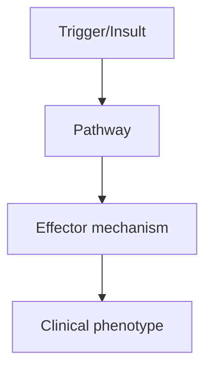
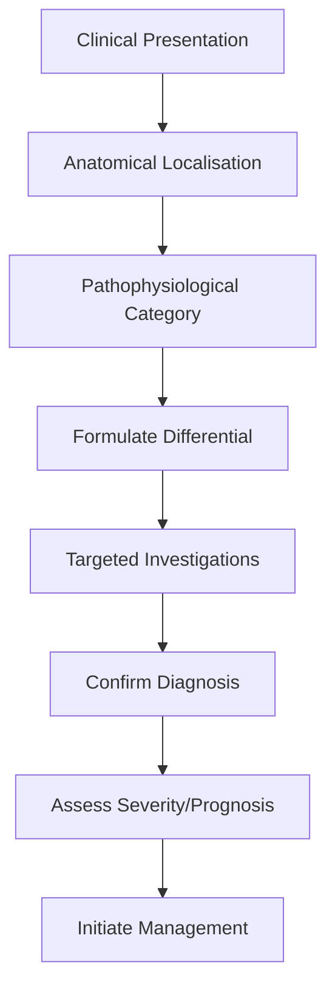
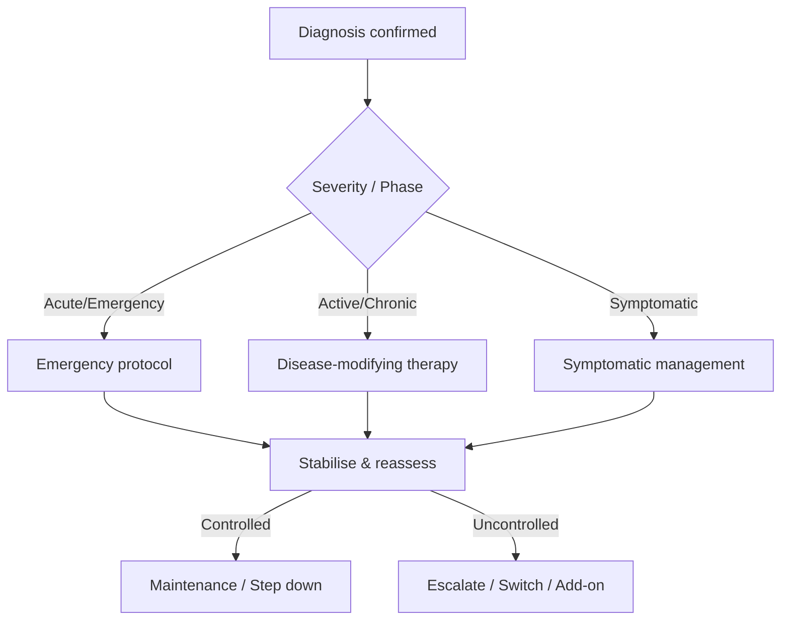
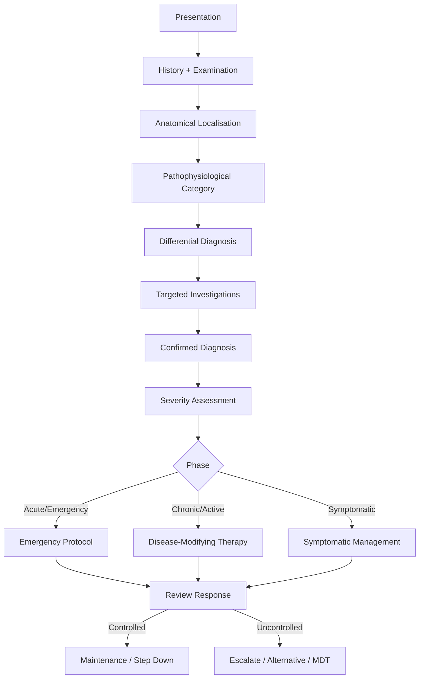

# {{Neurology Topic}}

Related: [[Neurological Examination]], [[Headache Approach]], [[Seizure Classification]], [[Movement Disorders]], [[Dementia Workup]], [[Neuromuscular Approach]], [[Spinal Cord Syndromes]], [[CNS Infections]], [[Coma Assessment]], [[Functional Neurological Disorders]]

> [!tip]
> Focus on anatomical localisation, clinical phenotyping, red flags, and stepwise management algorithms.

> [!tip]
> Add localisation clues, investigation pathways, emergency management, and FCPS/MRCP high-yield distinctions.

## Learning Objectives
- [ ] Define the condition and classify its variants
- [ ] Describe epidemiology and risk factors
- [ ] Explain pathophysiology and molecular mechanisms
- [ ] Localise the lesion anatomically and pathophysiologically
- [ ] List clinical features (history, examination findings, localisation signs)
- [ ] Outline diagnostic approach and investigations (including neuroimaging, neurophysiology, CSF)
- [ ] Differentiate from key mimics (differential diagnosis table)
- [ ] Detail management algorithm (stepwise, evidence-based, emergency vs chronic)
- [ ] Identify complications, red flags, and referral criteria
- [ ] Recall FCPS/MRCP high-yield facts, doses, durations, scoring systems
- [ ] Answer viva questions confidently
- [ ] Recognise common confusions and apply mnemonics

---

## 1. Definition / Epidemiology / Classification

### Definition

### Epidemiology
- **Incidence/Prevalence:**
- **Age/Peak onset:**
- **Sex ratio:**
- **Geographic/ethnic variation:**
- **Risk factors:**

### Classification
| Variant | Key Features | Prognosis |
|---------|-------------|-----------|
| | | |

---

## 2. Aetiology / Pathophysiology

### Aetiology
- **Genetic:**
- **Environmental:**
- **Immunological/Autoimmune:**
- **Infectious/Post-infectious:**
- **Vascular/Structural:**
- **Neoplastic/Paraneoplastic:**
- **Metabolic/Toxic:**
- **Drug-induced:**

### Pathophysiology


### Molecular/Genetic Basis
- **Key genes/mutations:**
- **Protein pathology:**
- **Autoantibodies:**
- **Biomarkers:**

---

## 3. Clinical Features

### History
- **Onset/Duration:**
- **Progression:** (acute, subacute, chronic, relapsing-remitting, progressive)
- **Key symptoms:**
- **Triggers/Exacerbating factors:**
- **Relieving factors:**
- **Systemic symptoms:**
- **Drug history:**
- **Family history:**
- **Past medical history:**

### Examination (Neurological Localisation)
| Domain | Key Findings | Localisation Value |
|--------|-------------|-------------------|
| **Higher cortical** | | |
| **Cranial nerves** | | |
| **Motor** | Tone, power, reflexes, involuntary movements | |
| **Sensory** | Modalities, distribution, level | |
| **Coordination** | Cerebellar vs sensory ataxia | |
| **Gait/Stance** | | |
| **Autonomic** | | |

### Specific Clinical Syndromes / Variants
| Syndrome/Variant | Key Features | Localisation |
|------------------|-------------|--------------|
| | | |

### Associated Findings
- **Systemic associations:**
- **Paraneoplastic markers:**
- **Comorbidities:**

---

## 4. Diagnostic Approach / Algorithm



### Diagnostic Criteria (if applicable)
| Criteria | Major | Minor |
|----------|-------|-------|
| | | |

### Severity Assessment / Staging
| Tool / Scale | Parameters | Cut-offs / Stages |
|--------------|-----------|------------------|
| | | |

---

## 5. Investigations

### First-Line
| Investigation | Indication | Expected Finding |
|---------------|------------|------------------|
| | | |

### Neuroimaging
| Modality | Indication | Key Findings | Protocol |
|----------|------------|--------------|----------|
| **CT Head** | | | |
| **MRI Brain/Spine** | | Sequences: | |
| **CT/MR Angiography** | | | |
| **PET/SPECT** | | | |

### Neurophysiology
| Test | Indication | Key Findings |
|------|------------|--------------|
| **EEG** | | |
| **NCS/EMG** | | |
| **Evoked Potentials** | | |
| **Polysomnography** | | |

### CSF Analysis
| Parameter | Normal | Typical Findings in This Condition |
|-----------|--------|-------------------------------------|
| **Opening pressure** | | |
| **WCC / Differential** | | |
| **Protein** | | |
| **Glucose (CSF:Serum)** | | |
| **Oligoclonal bands** | | |
| **Specific antibodies/PCR** | | |

### Laboratory / Serology
| Test | Indication | Interpretation |
|------|------------|----------------|
| | | |

### Genetic Testing
| Gene/Condition | Indication | Method |
|----------------|------------|--------|
| | | |

### Biopsy / Histopathology (if applicable)
| Feature | Finding |
|---------|---------|
| | |

---

## 6. Differential Diagnosis

| Differential | Distinguishing Features | Key Test / Localisation Clue |
|--------------|------------------------|------------------------------|
| | | |

---

## 7. Management

### Emergency / Acute Management (if applicable)
| Situation | Immediate Action | Time-Critical Steps |
|-----------|------------------|---------------------|
| | | |

### Disease-Modifying / Chronic Management
| Agent / Intervention | Indication | Dose / Regimen | Monitoring | Contraindications |
|---------------------|------------|----------------|------------|-------------------|
| | | | | |

### Symptomatic Management
| Symptom | First-line | Second-line | Refractory |
|---------|------------|-------------|------------|
| | | | |

### Rehabilitation / Multidisciplinary
| Domain | Intervention | Timing | Goals |
|--------|--------------|--------|-------|
| **Physiotherapy** | | | |
| **Occupational therapy** | | | |
| **Speech & language** | | | |
| **Psychology/Neuropsychology** | | | |
| **Social/Support** | | | |

### Surgical / Procedural (if applicable)
| Procedure | Indication | Technique | Complications |
|-----------|------------|-----------|---------------|
| | | | |

### Management Algorithm


### Treatment of Specific Variants
| Variant | First-line | Second-line | Refractory / Advanced |
|---------|------------|-------------|----------------------|
| | | | |

### Paediatric / Pregnancy / Elderly Adjustments
- **Pregnancy:**
- **Paediatric:**
- **Elderly/Frail:**
- **Renal impairment:**
- **Hepatic impairment:**

---

## 8. Drug Interactions / Contraindications / Comorbidity Cautions

| Drug | Interaction / Caution | Management |
|------|----------------------|------------|
| | | |

---

## 9. Procedures (if applicable)

### Procedure:
- **Indications:**
- **Contraindications:**
- **Preparation / Principle:**
- **Complications:**
- **Viva Pearls:**

---

## 10. Complications

| Complication | Frequency | Prevention / Monitoring | Management |
|--------------|-----------|------------------------|------------|
| | | | |

---

## 11. Red Flags / Emergencies

| Red Flag | Immediate Action | Time Window |
|----------|------------------|-------------|
| | | |

---

## 12. Prognosis

| Factor | Good Prognosis | Poor Prognosis |
|--------|----------------|----------------|
| | | |

- **Natural history:**
- **Recurrence/Relapse rate:**
- **Mortality (if applicable):**
- **Long-term sequelae / Disability:**

---

## 13. Topic Correlation

| Related Topic | Link | Key Overlap |
|---------------|------|-------------|
| | | |

---

## 14. Special Situations

| Situation | Consideration |
|-----------|---------------|
| **Pregnancy** | |
| **Lactation** | |
| **Paediatric** | |
| **Elderly / Frail** | |
| **Renal impairment** | |
| **Hepatic impairment** | |
| **Immunocompromised** | |
| **Perioperative** | |
| **Driving / DVLA** | |
| **Occupational** | |

---

## FCPS/MRCP High-Yield Summary

| Category | Key Points |
|----------|------------|
| **Definition** | |
| **Epidemiology** | |
| **Pathophysiology** | |
| **Localisation** | |
| **Clinical** | |
| **Diagnosis** | |
| **Investigations** | |
| **Management** | |
| **Complications** | |
| **Prognosis** | |
| **Viva Pearls** | |
| **Drug Doses** | |
| **Scoring Systems** | |
| **Genetics** | |
| **Imaging Signs** | |

---

## Viva Questions (PACES/FCPS Style)

1. **Q:** Define [topic] and classify its variants.
   **A:**

2. **Q:** How do you localise the lesion in [topic]?
   **A:**

3. **Q:** What are the diagnostic criteria for [topic]?
   **A:**

4. **Q:** How do you differentiate [topic] from [key differential]?
   **A:**

5. **Q:** Describe the stepwise management of [topic].
   **A:**

6. **Q:** What are the emergency presentations and immediate actions for [topic]?
   **A:**

7. **Q:** What investigations are indicated and in what order?
   **A:**

8. **Q:** What are the red flags requiring urgent referral in [topic]?
   **A:**

9. **Q:** How does management change in pregnancy/paediatrics/renal failure/elderly?
   **A:**

10. **Q:** What are the genetic associations with [topic]?
    **A:**

11. **Q:** Describe the neuroimaging/CSF findings in [topic].
    **A:**

12. **Q:** What is the prognosis and what factors influence it?
    **A:**

---

## Common Confusions / Exam Traps

| Confusion | Clarification |
|-----------|---------------|
| | |

---

## Mnemonics

1. **Mnemonic 1:** `ACRONYM` = Expansion (use: )
2. **Mnemonic 2:** `ACRONYM` = Expansion (use: )
3. **Mnemonic 3:** `ACRONYM` = Expansion (use: )
4. **Mnemonic 4:** `ACRONYM` = Expansion (use: )

---

## Mind Map

```mermaid
mindmap
  root(({{Neurology Topic}}))
    Definition
    Classification
    Aetiology
      Genetic
      Autoimmune
      Infectious
      Vascular
      Metabolic
    Pathophysiology
    Localisation
    Clinical
      History
      Examination
      Syndromes
    Investigations
      Neuroimaging
      Neurophysiology
      CSF
      Serology
      Genetic
    Differential
    Management
      Emergency
      Disease-modifying
      Symptomatic
      Rehabilitation
    Complications
    Prognosis
    Special Situations
      Pregnancy
      Paediatrics
      Elderly
      Driving
```

---

## Flowchart (Diagnostic/Management Algorithm)



---

## Suggested Visuals / Image Notes

| Image | Description | Source |
|-------|-------------|--------|
| | | |

---

## Suggested Video References

| Topic | Platform | Link/Duration |
|-------|----------|---------------|
| | | |

---

## One-Page Revision Card

| **Topic** | **{{Neurology Topic}}** |
|-----------|-------------------------|
| **Definition** | |
| **Key Clinical** | |
| **Localisation** | |
| **Dx Criteria** | |
| **Differentials** | |
| **Investigations** | |
| **Management (Steps)** | 1. 2. 3. 4. |
| **Key Drugs/Doses** | |
| **Red Flags** | |
| **Prognosis** | |
| **Viva Pearls** | |
| **Mnemonics** | |

---

## Spaced Repetition Trackers

### 24-Hour Recall Prompts
- [ ] Explain the topic in 2 minutes without looking at the note.
- [ ] Write the core diagnostic approach from memory.
- [ ] State first-line management and one important contraindication/caution.
- [ ] Compare this topic with one close differential diagnosis.
- [ ] Draw the management algorithm from memory.
- [ ] Identify the anatomical localisation and key examination signs.

### Revision Schedule
- [ ] **Day 1** completed (creation + 24h recall)
- [ ] **Day 3** revision completed
- [ ] **Day 7** revision completed
- [ ] **Day 15** revision completed
- [ ] **Day 30** revision completed
- [ ] **Day 90** revision completed

---

## Must Know / Should Know / Nice to Know

### Must Know (Core for passing)
- [ ]
- [ ]
- [ ]

### Should Know (High probability)
- [ ]
- [ ]
- [ ]

### Nice to Know (Differentiator)
- [ ]
- [ ]
- [ ]

---

## My Weak Points
- [ ]
- [ ]
- [ ]

---

## Self-Test Scorecard

| Section | Score /5 |
|---------|----------|
| Understanding: | /10 |
| Recall: | /10 |
| MCQ Performance: | /10 |
| SBA Performance: | /10 |
| Viva Confidence: | /10 |
| Total: | /50 |

> [!tip]
> **Interpretation:** <35 = weak topic, 35-44 = acceptable but insecure, 45+ = strong exam-ready topic.

---

## Exam Answer Modes

### Long Answer Skeleton
1. Definition & classification
2. Aetiopathogenesis & localisation
3. Clinical features (history, examination, syndromes)
4. Diagnostic criteria & investigations
5. Differential diagnosis
6. Management (stepwise algorithm, emergency + chronic)
7. Complications & prognosis
8. Special situations

### Short Note Skeleton
- Definition
- Key clinical features (3-4 points)
- Localisation clues
- Diagnosis (criteria + key test)
- Management (stepwise, 4 steps)
- Prognosis

### Viva One-Liners
- **Q:** Definition → **A:**
- **Q:** Localisation → **A:**
- **Q:** Key differential → **A:**
- **Q:** First-line treatment → **A:**
- **Q:** Red flag → **A:**
- **Q:** Pregnancy safety → **A:**

### Ward-Case Discussion Points
- Localisation practice
- Examination sign demonstration
- Investigation interpretation
- Management decision-making
- Patient counselling points

### Last-Night-Before-Exam Sheet
- Top 5 facts
- 3 drug doses
- 2 algorithms
- 1 mnemonic
- Must-know differential

---

## Summary

---

## MCQs (10)

1. **Question:** 
   **Options:** A. B. C. D.
   **Answer:**
   **Explanation:**

2. **Question:** 
   **Options:** A. B. C. D.
   **Answer:**
   **Explanation:**

3. **Question:** 
   **Options:** A. B. C. D.
   **Answer:**
   **Explanation:**

4. **Question:** 
   **Options:** A. B. C. D.
   **Answer:**
   **Explanation:**

5. **Question:** 
   **Options:** A. B. C. D.
   **Answer:**
   **Explanation:**

6. **Question:** 
   **Options:** A. B. C. D.
   **Answer:**
   **Explanation:**

7. **Question:** 
   **Options:** A. B. C. D.
   **Answer:**
   **Explanation:**

8. **Question:** 
   **Options:** A. B. C. D.
   **Answer:**
   **Explanation:**

9. **Question:** 
   **Options:** A. B. C. D.
   **Answer:**
   **Explanation:**

10. **Question:** 
    **Options:** A. B. C. D.
    **Answer:**
    **Explanation:**

---

## SBA Questions (10)

1. **Scenario:** 
   **Question:** 
   **Options:** A. B. C. D. E.
   **Answer:**
   **Explanation:**

2. **Scenario:** 
   **Question:** 
   **Options:** A. B. C. D. E.
   **Answer:**
   **Explanation:**

3. **Scenario:** 
   **Question:** 
   **Options:** A. B. C. D. E.
   **Answer:**
   **Explanation:**

4. **Scenario:** 
   **Question:** 
   **Options:** A. B. C. D. E.
   **Answer:**
   **Explanation:**

5. **Scenario:** 
   **Question:** 
   **Options:** A. B. C. D. E.
   **Answer:**
   **Explanation:**

6. **Scenario:** 
   **Question:** 
   **Options:** A. B. C. D. E.
   **Answer:**
   **Explanation:**

7. **Scenario:** 
   **Question:** 
   **Options:** A. B. C. D. E.
   **Answer:**
   **Explanation:**

8. **Scenario:** 
   **Question:** 
   **Options:** A. B. C. D. E.
   **Answer:**
   **Explanation:**

9. **Scenario:** 
   **Question:** 
   **Options:** A. B. C. D. E.
   **Answer:**
   **Explanation:**

10. **Scenario:** 
    **Question:** 
    **Options:** A. B. C. D. E.
    **Answer:**
    **Explanation:**

---

## Flashcards

- **Q:** 
  **A:**
- **Q:** 
  **A:**
- **Q:** 
  **A:**

---

## Answer Key with Explanations

### MCQs
1. 
2. 
3. 
4. 
5. 
6. 
7. 
8. 
9. 
10. 

### SBAs
1. 
2. 
3. 
4. 
5. 
6. 
7. 
8. 
9. 
10. 

---

## Local Navigation (for Dashboard UI)

**Heading Hub:** [[../XX_Section_Name/Section Name Hub]]  
**Topic-Group Hub:** [[../XX_Section_Name/Topic Group Hub]]  
**Chapter Hierarchy:** [[Davidson Chapter 25 - Neurology Hierarchy]]  
**Chapter MOC:** [[Neurology MOC]]  
**Drug Reference:** [[../00_Index/Neurology Drug Reference]]  
**Related Topics:** [[Related Topic 1]], [[Related Topic 2]]