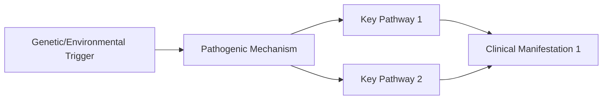
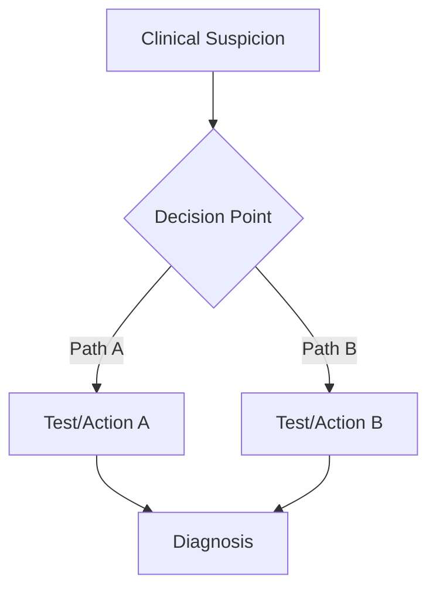
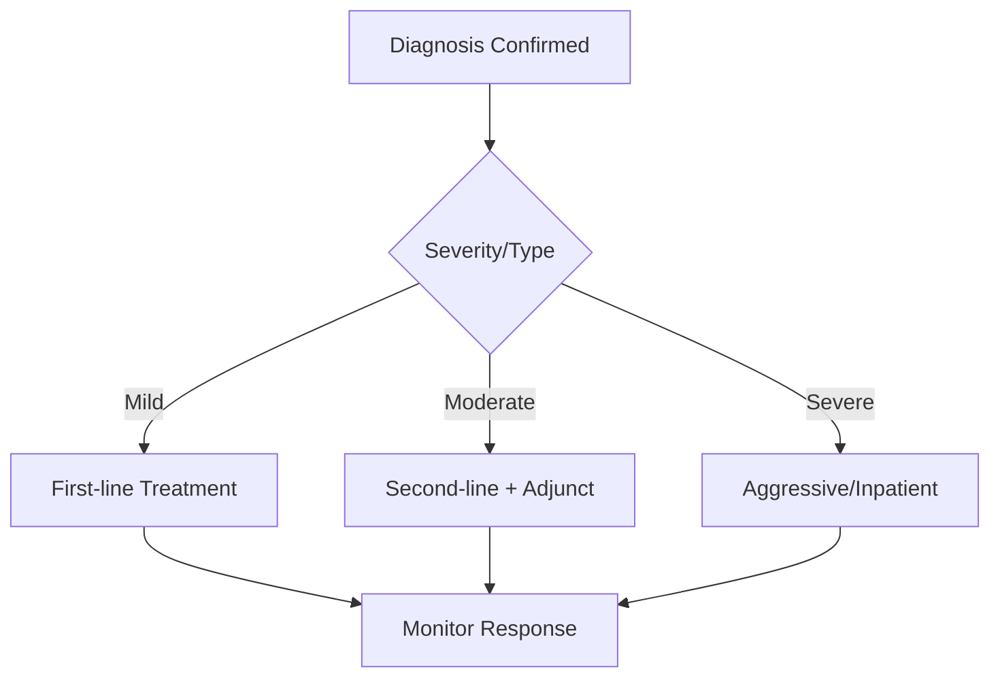
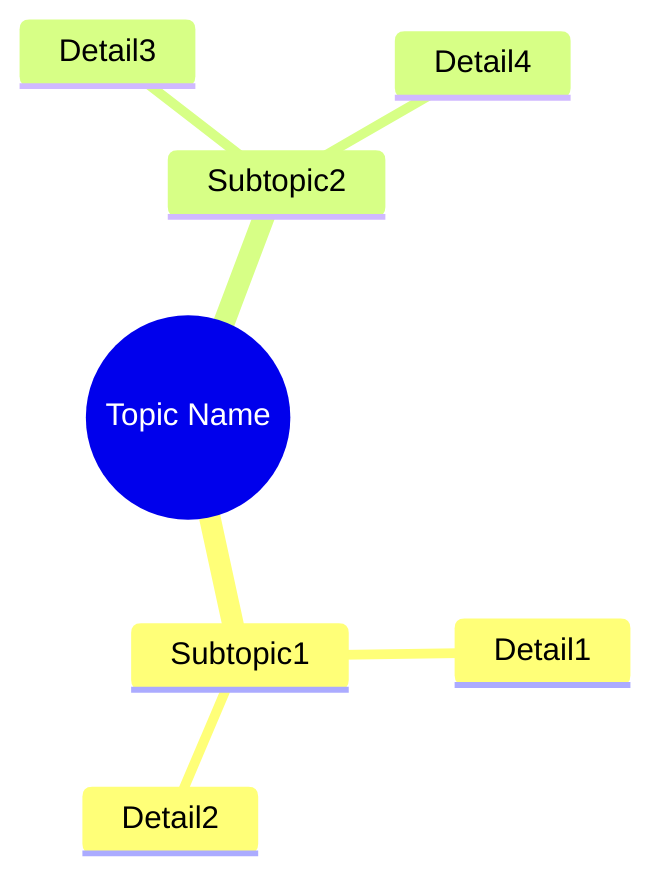

# Disease/Topic Name

> [!tip] **FCPS/MRCP Priority: CRITICAL/HIGH/MEDIUM**
> One-line exam relevance statement. Why this is guaranteed viva/SBA/OSCE topic.

---

## Learning Objectives
By the end of this note you should be able to:
- [ ] Objective 1 (specific, measurable)
- [ ] Objective 2
- [ ] Objective 3
- [ ] Objective 4
- [ ] Objective 5
- [ ] Objective 6

---

## 1. Definition & Epidemiology

| Feature | Detail |
|---------|--------|
| **Definition** | Concise definition |
| **Incidence/Prevalence** | Numbers |
| **Peak Onset** | Age range |
| **Sex Ratio** | M:F ratio |
| **Risk Factors** | Key modifiable/non-modifiable |

---

## 2. Aetiology & Pathophysiology

### Key Pathogenic Concepts
| Concept | Detail | Therapeutic Target |
|---------|--------|-------------------|
| Concept 1 | Detail | Drug target |
| Concept 2 | Detail | Drug target |

---

## 3. Clinical Features

| System/Domain | Feature | FCPS/MRCP Pearl |
|---------------|---------|-----------------|
| System 1 | Description | High-yield point |
| System 2 | Description | High-yield point |

> [!critical] **Key Differentiator**
> Critical distinguishing feature vs mimics.

---

## 4. Classification / Diagnostic Criteria

### Current Criteria (Year)
| Criterion | Requirement |
|-----------|-------------|
| Criterion 1 | Detail |
| Criterion 2 | Detail |

**Diagnosis: X criteria total (including Y major) + Exclusions met**

> [!important] **Alternative Criteria**
> Brief mention if applicable.

---

## 5. Investigations & Diagnostic Algorithm

### Key Investigation Table
| Test | Role | Typical Finding |
|------|------|----------------|
| Test 1 | Purpose | Finding |
| Test 2 | Purpose | Finding |

> [!warning] **Pitfall**
> Common diagnostic trap.

---

## 6. Differential Diagnosis

| Mimic | Distinguishing Features |
|-------|------------------------|
| Condition 1 | Key differentiator |
| Condition 2 | Key differentiator |

---

## 7. Management

### Step-by-Step Management

| Step | Intervention | Details |
|------|--------------|---------|
| 1 | First-line | Dose, duration, monitoring |
| 2 | Second-line | When to escalate |
| 3 | Refractory | Options |

> [!critical] **Key Management Point**
> Critical decision point or contraindication.

---

## 8. Complications

| Complication | Frequency | Detail |
|--------------|-----------|--------|
| Comp 1 | % | Description |
| Comp 2 | % | Description |

---

## 9. Special Populations

| Population | Consideration |
|------------|---------------|
| Pregnancy | Drug safety, monitoring |
| Paediatrics | Dosing, presentation differences |
| Renal/Hepatic Impairment | Dose adjustments |
| Elderly | Frailty, polypharmacy |

---

## 10. FCPS/MRCP High-Yield Summary

| Topic | Key Points |
|-------|------------|
| Topic 1 | Bullet 1, Bullet 2 |
| Topic 2 | Bullet 1, Bullet 2 |

---

## 11. Viva Questions (MRCP PACES / FCPS)

| Question | Expected Answer |
|----------|----------------|
| Question 1 | Expected answer |
| Question 2 | Expected answer |

---

## 12. Confusions & Mnemonics

| Confusion | Clarification |
|-----------|---------------|
| Common confusion 1 | Clear distinction |
| Common confusion 2 | Clear distinction |

**Mnemonic: NAME = "Acronym Expansion"**
- **A** = Word
- **C** = Word

---

## 13. Mind Map

---

## 14. One-Page Revision Card

| Domain | Key Points |
|--------|------------|
| Domain 1 | Key points |
| Domain 2 | Key points |

---

## 15. Spaced Repetition Trackers

| Review Interval | Date Completed | Confidence (1-5) | Notes |
|-----------------|----------------|------------------|-------|
| 24 hours | | | |
| 7 days | | | |
| 15 days | | | |
| 30 days | | | |
| 90 days | | | |

---

## 16. Self-Test Scorecard

| Section | Score /5 | Last Attempt |
|---------|----------|--------------|
| Section 1 | | |
| Section 2 | | |

---

## Local Navigation
- **Parent Heading**: [[../Heading Hub Name|Heading Hub Name]]
- **Parent Topic Group**: [[Topic Group Name]]
- **Chapter Map**: [[../Textbook Chapter Hierarchy|Textbook Chapter Hierarchy]]
- **Chapter MOC**: [[../Specialty MOC|Specialty MOC]]
- **Drug Reference**: [[../../Clinical Approach/Drugs|Drugs Reference]]
- **Investigation Reference**: [[../../Clinical Approach/Investigations|Investigations Reference]]
- **Related**: [[Related Topic 1]] · [[Related Topic 2]]