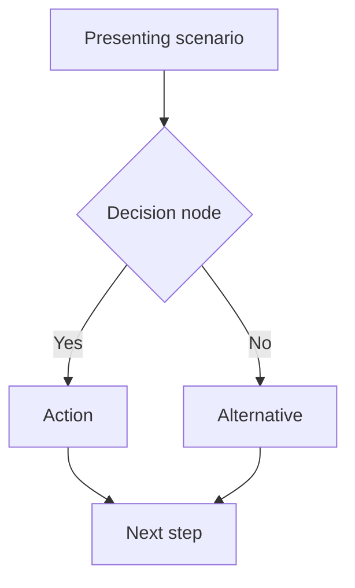
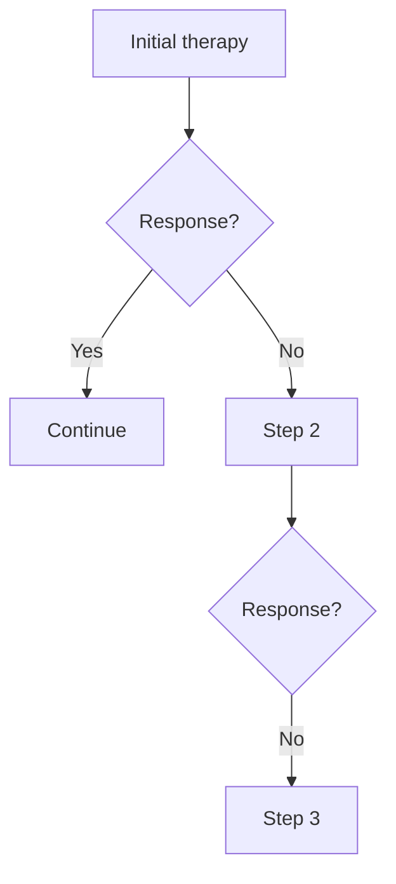

# Cardiology Workflow Lessons (from 2026-06-10 session)

## Refined FCPS/MRCP Note Template Structure
The proven full-note structure for cardiology (and applicable to other chapters):

```yaml
---
tags: [medicine, cardiology, davidson, <topic-tags>, fcps, mrcp]
chapter: Cardiology
davidson_part: Part 3: Clinical Medicine
davidson_chapter: Chapter 16: Cardiology
heading: <Heading hub name>
topic_group: <Topic-group hub name>
topic: <Exact topic name>
status: full-fcps-mrcp-note
updated: YYYY-MM-DD
---
```

**Required Sections (in order):**
1. **Learning Objectives** (bulleted)
2. **Definition** / Classification tables
3. **Pathophysiology** / Mechanisms
4. **Clinical Features** / Presentations
5. **Diagnosis** / Assessment algorithms (with mermaid flowcharts)
6. **Management** / Treatment algorithms (with mermaid)
7. **Drug Interactions / Contraindications / Comorbidity Cautions**
8. **Procedures / Indications / Contraindications**
9. **Complications of Mismanagement**
10. **Red Flags / Emergencies**
11. **Prognosis** (with data tables)
12. **Topic Correlation** (Obsidian links)
13. **Special Situations** (pregnancy, elderly, COVID, etc.)
14. **FCPS/MRCP High-Yield Points** (bulleted)
15. **Common Viva Questions** (numbered)
16. **Common Confusions / Exam Traps** (bulleted)
17. **Mnemonics** (structured)
18. **Mind Map** (text outline)
19. **Suggested Visuals / Image Notes**
20. **Suggested Video References**
21. **One-Page Revision Summary** (concise bullets)
22. **24-Hour Recall Prompts** (active recall)
23. **7-Day / 15-Day / 30-Day Revision Tracker**
24. **Must Know / Should Know / Nice to Know** (tiered)
25. **My Weak Points** (checkboxes)
26. **Self-Test Scorecard** (5 domains /10)
27. **Exam Answer Modes** (placeholder)

## Mermaid Diagram Patterns Used

### Algorithm Flowchart


### Treatment Escalation Ladder


## Cardiology Batch Git Workflow

1. **Read session resume** → identify next N topics
2. **Write all N notes** in one turn (or small batches to avoid stream timeout)
3. **Update MOC.md** → add ✅ markers for each completed topic
4. **Update Hierarchy.md** → add ✅ markers, remove duplicates
5. **Update Session Resume** → mark completed, adjust queue
6. **Single git add/commit/push** for the batch:
   ```bash
   git add Cardiology/<all new files> Cardiology/MOC.md Cardiology/Hierarchy.md 00_Index/Resume.md
   git commit -m "feat(cardiology): add N full FCPS/MRCP notes (topic1, topic2, ...)"
   git push
   ```

## MOC & Hierarchy Update Rules
- **MOC**: Add entries under relevant heading with `  - ✅ [[Path|Topic]] — full FCPS/MRCP note completed`
- **Hierarchy**: Add `✅` prefix to disease-level items; mark topic-group hubs with `✅` when ALL children complete
- **Remove duplicates** (some topics appear in multiple parent groups — keep one definitive ✅ entry)
- **Count updated** in MOC header: "verified full FCPS/MRCP notes: XX"

## Session Resume Update Rules
- Mark completed items with `— ✅ COMPLETED`
- Adjust queue order
- Update "Recommended safe next command" with next target

## Pitfalls Avoided This Session
- **Stream timeout**: Write large notes individually, not in one massive write_file
- **False completion claims**: Only mark ✅ after file write verified on disk
- **Missing hub files**: 20 topic-group hubs and 10 heading hubs are `scaffold-hub` by design — don't convert to full notes
- **Root-level core notes**: 12 preserved notes stay as legacy; don't upgrade them
- **Duplicate hierarchy entries**: Clean up before adding new ✅ markers

## Reference Notes
- Total disease-level topics: 103
- Target: 103 full notes + 20 scaffold-hubs + 10 heading hubs + 12 root core notes
- Current completion: 111 full notes (includes 8 legacy notes upgraded this session)