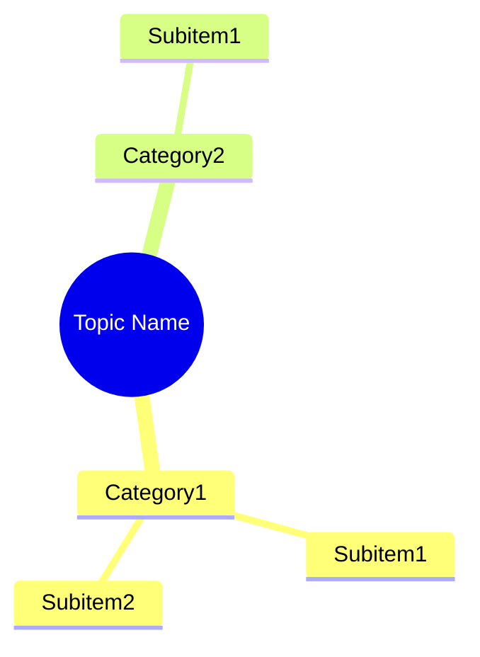
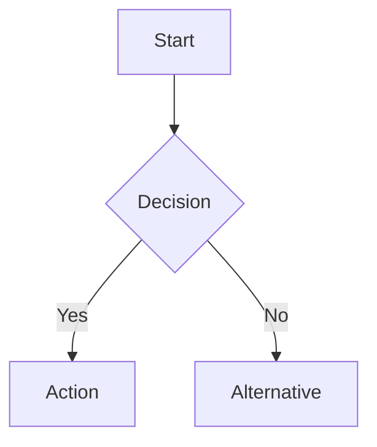

# File Size Guidelines and Content Structure Standards

This document establishes standardized file size guidelines and content structure standards for FCPS/MRCP medical topic files created using the medical-chapter-study-pack workflow.

## File Size Guidelines by Topic Type

| Topic Category | Expected Size Range | Target Size | Notes |
|----------------|---------------------|-------------|-------|
| **Core Clinical Topics** (AKI, CKD, Malignancies, Glomerular Diseases) | 15–25 KB | ~20 KB | Full FCPS/MRCP content with detailed tables, mind maps, 10 MCQs + 10 SBAs |
| **Assessment & Physiology Topics** (GFR, Blood Tests, Examination) | 15–20 KB | ~16–18 KB | Strong physiology focus, formulas, tables |
| **Infectious/Inflammatory Topics** (UTI, AKI, Glomerulonephritides) | 17–22 KB | ~18–20 KB | Detailed pathogens, antibiotics, algorithms |
| **Surgical/Interventional Topics** (Stones, Transplant, Surgery) | 17–20 KB | ~18 KB | Procedures, algorithms, imaging criteria |
| **Complex/Multi-system Topics** (Systemic Conditions, Malignancies) | 18–25 KB | ~20–22 KB | Cross-system integration, multiple tables |
| **Assessment/Overview Topics** (Screening, Clinical Exam) | 5–7 KB | ~6 KB | Focused, practical reference |
| **Template/Scaffold Files** | 3–7 KB | ~5–7 KB | Structural, minimal content |

---

## Total Project Size Expectations

| Project Scope | Expected Total Files | Expected Total Size |
|---------------|----------------------|---------------------|
| **Single Chapter (22 topics)** | 22 topics + 3 supporting = 25 files | ~300–400 KB |
| **Single Section (5-6 topics)** | 5–6 topics + 1 template | ~80–120 KB |
| **Single Topic File** | 1 topic | 15–25 KB (core), 5–7 KB (scaffold) |

---

## Content Structure Standards

### Required Frontmatter (All Topic Files)
```yaml
---
tags: [medicine, davidson, chapterXX, specialty, fcps, mrcp]
davidson_chapter: Chapter XX: Chapter Name
topic_category: Category Name
status: scaffold | full-fcps-mrcp-topic-note
---
```

### Required Content Sections (in order)

| Section | Required | Description |
|---------|----------|-------------|
| **Learning Objectives** | ✅ | 3-5 measurable objectives |
| **Definitions / Key Concepts** | ✅ | Table format preferred |
| **Core Content Sections** | ✅ | 3-6 major sections with tables |
| **Clinical Presentation** | ✅ | History, Examination, Syndromes table |
| **Diagnostic Approach** | ✅ | Labs, Imaging, Special tests |
| **Management** | ✅ | Principles, Pharmacological, Procedural |
| **Complications** | ✅ | Prevention, Recognition, Management |
| **High-Yield FCPS/MRCP Points** | ✅ | Callout box with key points |
| **Common Confusions / Exam Traps** | ✅ | Table format |
| **Mnemonics** | ✅ | 3-8 mnemonics |
| **Mind Map** | ✅ | Mermaid diagram |
| **Flowchart** | ✅ | Mermaid diagram (for algorithms) |
| **24-Hour Recall Prompts** | ✅ | 5-10 prompts |
| **7/15/30-Day Revision Tracker** | ✅ | Table with Date, Recall, Notes |
| **Must/Should/Nice-to-Know** | ✅ | Table with priorities |
| **10 MCQs** | ✅ | With answer key & explanations |
| **10 SBA Questions** | ✅ | Clinical scenarios with explanations |
| **Flashcards** | ✅ | 10-15 cards |
| **Answer Keys with Explanations** | ✅ | For all MCQs and SBAs |
| **Summary** | ✅ | Key takeaway, exam focus, clinical relevance |

---

## Mermaid Diagram Standards

### Mind Maps


### Flowcharts


### Style Guidelines
- Use consistent capitalization (Title Case for nodes)
- Keep node text concise (<30 chars)
- Use standard shapes (rectangles, diamonds)
- Limit depth to 4 levels

---

## Question Standards

### MCQ Standards (10 per topic)
| Element | Standard |
|---------|----------|
| **Question stem** | Clear clinical scenario or direct question |
| **Options** | 5 options (A-E), one correct |
| **Difficulty** | FCPS/MRCP level (not USMLE) |
| **Answer Key** | Required with explanation |
| **Topic Distribution** | 2 definitions, 3 clinical, 2 management, 2 complications, 1 guideline |

### SBA Standards (10 per topic)
| Element | Standard |
|---------|----------|
| **Clinical scenario** | Realistic patient vignette |
| **Options** | 5 options (A-E), one best answer |
| **Difficulty** | Ward/clinical decision level |
| **Answer Key** | Required with explanation |

### Flashcards (10-15 per topic)
| Format | Standard |
|--------|----------|
| **Format** | "Q: ...\nA: ..." |
| **Focus** | High-yield facts, criteria, thresholds, classifications |
| **Count** | 10-15 cards |

---

## Quality Assurance Checklist

### Pre-Submission Checklist (Per Topic)
- [ ] Frontmatter complete (tags, davidson_chapter, topic_category, status)
- [ ] All 20+ content sections present
- [ ] 10 MCQs with answer key
- [ ] 10 SBAs with answer key
- [ ] 10-15 Flashcards
- [ ] Mind map (Mermaid)
- [ ] Flowchart (Mermaid)
- [ ] 24-Hour Recall Prompts (5-10)
- [ ] 7/15/30-Day Revision Tracker
- [ ] Must/Should/Nice-to-Know Table
- [ ] Cross-chapter links (Related wikilinks)
- [ ] Tags: medicine, davidson, chapterXX, specialty, fcps, mrcp
- [ ] davidson_chapter frontmatter field correct
- [ ] topic_category field correct
- [ ] status field appropriate

### Project-Level Verification
- [ ] Total file count = topics + 3 supporting files
- [ ] MOC updated with ✅ markers
- [ ] Hierarchy updated with completion status
- [ ] Cross-chapter links verified
- [ ] File count matches expectation
- [ ] Web search validation completed

---

## Project Organization Standards

### Directory Structure
```
/mnt/tb/Medicine/<Specialty>/
├── <Chapter> MOC.md
├── <Chapter> Hierarchy.md
├── Templates/
│   └── <Specialty> Topic Template.md
├── Topic1.md
├── Topic2.md
│   ...
├── TopicN.md
└── References/
    ├── chapter-XX-completion-workflow.md
    ├── file-size-guidelines.md
    └── ...
```

### Naming Conventions
- **Topic files**: Title Case with spaces (e.g., "Acute Kidney Injury (AKI).md")
- **Supporting files**: Descriptive names with spaces (e.g., "Chapter 12 - HIV Infection and AIDS Hierarchy.md")
- **Template**: "<Specialty> Topic Template.md"
- **References**: Lowercase with hyphens (e.g., "chapter-15-completion-workflow.md")

---

*These guidelines ensure consistency, quality, and exam-readiness across all medical topic files created with the medical-chapter-study-pack workflow.*